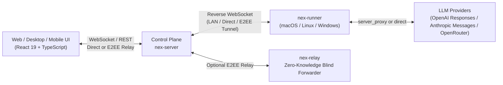

# Nex

English | [简体中文](./README.zh-CN.md)

**Nex** is a pure-Go (`CGO_ENABLED=0`), multi-runner AI Agent Workbench & Harness. It pairs a centralized Control Plane (`nex-server`) with distributed cross-platform Runners (`nex-runner` across macOS, Linux, and Windows), zero-trust E2EE NAT traversal (`nex-relay`), and a unified Web / Desktop / Mobile workbench (`nex-app` & `clients/web`).

---

## Architecture



- **`nex-server`** (`cmd/nex-server`): Control plane hosting SQLite WAL storage (`main.db` & cold `archive.db`), `models.dev` metadata cache, `/llm-proxy/*` gateway (injecting server-held API keys over `server_proxy`), SSH deployment orchestration, runner self-update coordinator, and embedded Web UI (`pkg/webui/dist`).
- **`nex-runner`** (`cmd/nex-runner`): Lightweight headless execution agent with local SQLite outbox/cache, zstd CAS blobs, file/git workspace services, ConPTY/PTY sessions, browser automation, `cron` scheduler, local MCP + `goja` Code Mode sandbox, and automatic reconnect via LAN, direct endpoint, or `nex-relay`.
- **`nex-relay`** (`cmd/nex-relay`): Blind encrypted WebSocket relay enabling `nex-runner` and remote clients to connect seamlessly behind NAT/firewalls without exposing inbound ports.
- **`nex-app`** (`cmd/nex-app`): `egoist/mygo`-based native Desktop & Mobile shell embedding the same React workbench.

---

## Core Capabilities

### Multi-Runner & Zero-Trust Connectivity
- **Distributed Runners**: Run agents simultaneously across local laptops, build servers, and remote Linux/macOS/Windows nodes. Rename any connected runner inline and filter workspaces by runner in the task sidebar.
- **One-Click SSH Deployment**: Import hosts from `~/.ssh/config`, paste `user@host:port`, test connectivity, deploy via SCP upload or remote install, inspect logs, and stop remote daemons directly in Settings.
- **E2EE Pairing & NAT Traversal**: Pair devices via `nex://pair?...` URIs backed by `nex-relay`. Runners configured with `server_proxy` automatically tunnel `/llm-proxy/*` requests over their active connection (including E2EE relay tunnels) so remote nodes never need raw API keys on disk.
- **Fleet Self-Update**: Zero-CGO cross-compiled runner updates with compatibility gates, idle draining (`when_idle` / `immediate`), SHA-256 verification, and automatic rollback.

### Multi-Provider LLMs, Multimodal & Guardrails
- **Dual Core Streaming Protocols**: Native streaming adapters for **OpenAI / Codex Responses API** (`/v1/responses`) and **Anthropic Messages API** (`/v1/messages`), preserving reasoning items and thinking signatures across multi-turn tool calls.
- **Multimodal Suite**: Image generation (`generate_image`), speech-to-text transcription, PDF & vision understanding, plus **Jev** fast classifier routing (`pkg/harness/tools/jev_guardrail.go`).
- **Permission Modes**: `interactive` (confirm before changes — default), `full_access`, `plan` (read-only plan before switching to execution), and `read_only`.

### Integrated Agent Workbench
- **Multi-Runner Sidebar Organization**: Smart project grouping by Runner + Workspace, Active & Unread section, Time-bucketed Recent view, colored/minimal Runner badge styles, and `Cmd/Ctrl+K` command palette.
- **Right-Side Multi-Tab Inspector**:
  - **Files Tree & Live Preview**: Lazy remote directory browser with new-tab code, image, and PDF preview.
  - **Git Review & Diff**: Inline `[+X -Y]` diff viewer for uncommitted changes across workspaces.
  - **Context Windows & Subagents**: 6-category token breakdown inspector, turn telemetry, and live subagent conversation inspection.
  - **Integrated Browser Use**: Embedded headless/controlled browser pane with screenshot inspection and interactive control.
- **`libghostty` WASM Terminal**: Embedded bottom and split-pane terminal powered by `coder/ghostty-web` (`libghostty-vt.wasm`) over binary WebSocket PTY (`ConPTY` on Windows, POSIX PTY on macOS/Linux).

### Extensibility, Memory & Analytics
- **Lazy MCP + `goja` Code Mode**: On-demand discovery (`searchTools` / `describeTool`), spawn-on-first-call with idle-TTL reaping for local `stdio` MCP servers, and sandboxed JS batching inside `goja`.
- **TypeScript Dynamic Plugins**: Server-side pure-Go `esbuild` bundling with Runner-side `goja` execution, `/slash` commands, lifecycle hooks, and declarative `ctx.ui` prompts.
- **Global Instructions & Memory**: Persistent Global Instructions (`~/.nex/AGENTS.md`) and scoped long-term memories synced to all connected runners.
- **Cold/Hot Archiving & Usage Analytics**: Non-blocking session archiving between `main.db` and `archive.db`, hourly rollups (`Today` / `7D` / `30D`), token composition & interactive trend charts, prompt-cache savings tracking, and per-model cost rankings.

---

## Quick Start

### Prerequisites
- **Go 1.24+** (`CGO_ENABLED=0` compatible, no C compiler needed)
- **Node.js 20+** and **npm** (for building `clients/web` into `pkg/webui/dist`)

### Run Locally (Server + Runner + Embedded Web UI)

```bash
# Build frontend assets and Go binaries (nex-server, nex-runner, nex-relay, nex-app) and start locally
make run-local
```

Then open `http://127.0.0.1:8080`.

### Build Binaries Manually

```bash
# 1. Build embedded Web UI (outputs to pkg/webui/dist)
npm --prefix clients/web install
npm --prefix clients/web run build

# 2. Build pure-Go binaries into bin/
make build
```

Cross-compile `nex-runner` across all supported OS/architectures:

```bash
make build-runners
```

### Connect a Remote Runner

Using direct LAN WebSocket:

```bash
./nex-runner -name "My-Linux-Box" -server ws://<server-host>:8080/ws/runner -token "<pairing-secret>"
```

Using NAT/E2EE pairing URI generated in **Settings -> Remote Devices**:

```bash
./nex-runner -name "My-Remote-Box" -pair "nex://pair?..."
```

---

## Verification & Development

```bash
# Run Web unit tests (Vitest + strict i18n parity check)
make test-web

# Build Web UI bundle (updates pkg/webui/dist)
make build-web

# Run full pure-Go test suite with race detector & coverage
make test

# Verify pure-Go CGO_ENABLED=0 cross-compilation
make verify-nocgo
```

## Project Structure

- `cmd/nex-server` — Control Plane Server CLI & entrypoint
- `cmd/nex-runner` — Cross-platform Agent Runner daemon
- `cmd/nex-relay` — Zero-knowledge E2EE WebSocket relay server
- `cmd/nex-app` — Desktop & Mobile shell (`egoist/mygo`)
- `pkg/agent` — Core agent loop, prompt builder, compaction, and hooks
- `pkg/ai` — Streaming provider adapters (OpenAI Responses, Anthropic Messages, multimodal, classifiers)
- `pkg/harness` — Tools (`bash`, `edit`, `read`, `write`, MCP Code Mode, browser, Jev guardrail), workspace & git services
- `pkg/store` — Pure-Go SQLite (`main.db` / `archive.db`), CAS blobs, usage rollups, encrypted credential vault
- `pkg/server` — REST/WS API, `/llm-proxy/*` gateway, SSH orchestration, runner updater
- `pkg/remote` & `pkg/relay` — Zero-trust device pairing & E2EE tunnel transport
- `clients/web` — React 19 + TypeScript + Tailwind v4 + Zustand workbench UI
- `docs/` — Detailed architecture specifications ([`docs/01-architecture-spec.md`](docs/01-architecture-spec.md) – [`docs/08-implementation-roadmap.md`](docs/08-implementation-roadmap.md))
