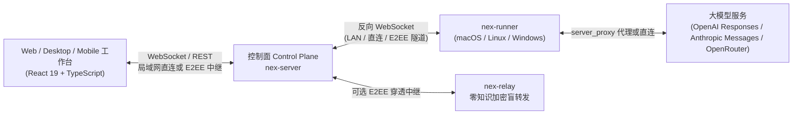

# Nex

[English](./README.md) | 简体中文

**Nex** 是一个纯 Go（`CGO_ENABLED=0`）编写的多节点自主 AI Agent 工作台与 Harness。它由中心控制面（`nex-server`）、跨平台分布式执行节点（`nex-runner`，支持 macOS / Linux / Windows）、零信任端到端加密内网穿透中继（`nex-relay`）以及统一 Web / 桌面 / 移动端工作台（`nex-app` 与 `clients/web`）组成。

---

## 整体架构



- **`nex-server`**（`cmd/nex-server`）：控制面服务，负责双 SQLite WAL 存储（热库 `main.db` 与冷库 `archive.db`）、`models.dev` 元数据缓存、`/llm-proxy/*` 密钥注入网关、SSH 一键部署编排、Runner 在线升级调度，以及内嵌前端静态资源（`pkg/webui/dist`）。
- **`nex-runner`**（`cmd/nex-runner`）：轻量级无头执行节点，内置本地 SQLite Outbox 缓存、Zstd CAS 对象存储、工作区文件与 Git Diff 服务、`ConPTY` / POSIX PTY 终端、集成浏览器控制、`cron` 定时任务、按需懒加载 MCP + `goja` Code Mode 沙箱，支持断线自动重连与三模路由回退（LAN → 公网直连 → `nex-relay`）。
- **`nex-relay`**（`cmd/nex-relay`）：零知识 E2EE WebSocket 中继节点，无需在家庭或内网主机暴露公网端口，即可让远程 `nex-runner` 与客户端安全互联。
- **`nex-app`**（`cmd/nex-app`）：基于 `egoist/mygo` 的原生桌面与移动端外壳，直接复用统一的 React 工作台。

---

## 核心特性

### 多节点 Runner 与零信任组网
- **多设备协同工作**：同时接入本地开发机、远程 Linux 构建机与 Windows 主机；支持在设置中直接在线修改 Runner 显示名称，并在任务侧边栏按 Runner 快速筛选工作区。
- **SSH 一键部署与运维**：支持自动读取 `~/.ssh/config` 或直接粘贴 `user@host:port`，在弹窗内完成连通性测试、SCP 上传或远程拉取部署、日志查看及停止远端守护进程。
- **E2EE 配对与 NAT 穿透**：通过设置页生成 `nex://pair?...` 配对命令接入内网主机；当模型 Provider 配置为 `server_proxy` 时，Runner 会自动复用当前活跃连接通道（包括 `nex-relay` E2EE 隧道）转发 `/llm-proxy/*` 请求，远端节点无需明文保存 API Key。
- **无 CGO 跨平台升级**：服务端统一校验兼容性与版本，支持空闲等待升级（`when_idle`）与强制立即升级（`immediate`）、SHA-256 校验与失败自动回滚。

### 多模型协议、多模态与权限护栏
- **双核心流式协议**：原生支持 **OpenAI / Codex Responses API**（`/v1/responses`）与 **Anthropic Messages API**（`/v1/messages`），跨多轮工具调用完整保留推理状态与 Thinking 签名。
- **全能多模态接入**：支持图片生成（`generate_image`）、语音转文字、图像/PDF 理解，以及 **Jev** 快速分类器路由与安全审计扩展点（`pkg/harness/tools/jev_guardrail.go`）。
- **细粒度权限模式**：提供「**变更前确认**（默认）」、「**完全访问**」、「**计划模式**」与「**只读浏览**」四种模式；交互式提问卡片支持单选自动跳转下一题或自动提交，并仅在对话视图中展示。

### 一体化 Agent 工作台
- **更高效的多节点侧边栏**：支持「项目 / 最近」双视图切换、「活跃与未读」置顶、按最近活跃智能折叠，以及多色调/极简边框 Runner 标签样式与 `Cmd/Ctrl+K` 全局命令面板。
- **右侧多标签检查器**：
  - **工作区文件树与新标签预览**：懒加载远端目录树，支持代码、图片与 PDF 内嵌预览。
  - **Git Diff 审查（Review）**：实时展示 `[+X -Y]` 未提交改动，直接定位具体变更行。
  - **上下文窗口与子智能体检查**：6 类 Token 构成分析、单轮 Telemetry 耗时与 TTFT 统计，以及子智能体实时对话追踪。
  - **集成浏览器（Browser Use）**：内置受控浏览器面板，支持页面状态实时预览与交互。
- **`libghostty` WASM 终端**：基于 `coder/ghostty-web`（`libghostty-vt.wasm`）的二进制 WebSocket PTY 终端，全面兼容 Windows `ConPTY` 与 macOS / Linux PTY。

### 扩展能力、记忆系统与用量统计
- **懒加载 MCP + `goja` Code Mode**：通过 `searchTools` / `describeTool` 按需检索工具，避免上下文膨胀；本地 `stdio` MCP 首次调用拉起并在空闲后自动回收；支持在隔离的 `goja` 沙箱中并发编排工具调用。
- **TypeScript 动态插件**：服务端纯 Go `esbuild` 实时编译，Runner 端 `goja` 运行，支持生命周期钩子、`/slash` 斜杠命令及远端声明式交互。
- **全局指令与长期记忆**：全局指令（`~/.nex/AGENTS.md`）与全局/项目级记忆自动同步至所有在线 Runner，持久生效。
- **冷热分离归档与可视化用量图表**：闲置会话自动无损迁移至 `archive.db` 且保留历史开销；「今日 / 近 7 天 / 近 30 天」小时级与天级可视化柱状图，直观展示 Token 构成（Input / Output / Cache Read）、费用曲线、Prompt Cache 节省金额与模型成本排行。

---

## 快速开始

### 环境要求
- **Go 1.24+**（支持 `CGO_ENABLED=0` 纯 Go 编译，无需 C 编译器）
- **Node.js 20+** 与 **npm**（用于构建 `clients/web` 至 `pkg/webui/dist`）

### 一键本地启动

```bash
# 构建前端资源与 Go 核心二进制（nex-server、nex-runner、nex-relay、nex-app）并本地启动
make run-local
```

启动后访问 `http://127.0.0.1:8080`。

### 手动分步构建

```bash
# 1. 构建并嵌入 Web UI（输出至 pkg/webui/dist）
npm --prefix clients/web install
npm --prefix clients/web run build

# 2. 编译纯 Go 二进制文件至 bin/
make build
```

交叉编译全平台 `nex-runner`（`linux/amd64`、`linux/arm64`、`darwin/arm64`、`darwin/amd64`、`windows/amd64`）：

```bash
make build-runners
```

### 接入远程 Runner

通过局域网 / 直连 WebSocket 接入：

```bash
./nex-runner -name "My-Linux-Box" -server ws://<server-host>:8080/ws/runner -token "<pairing-secret>"
```

通过 **设置 -> 远程设备** 生成的 E2EE 配对口令穿透接入：

```bash
./nex-runner -name "My-Remote-Box" -pair "nex://pair?..."
```

---

## 测试与开发命令

```bash
# 运行前端单元测试（包含 i18n 键/占位符全量一致性及硬编码语言检查）
make test-web

# 构建前端静态包并嵌入 pkg/webui/dist
make build-web

# 运行全量 Go 竞态与覆盖率测试
make test

# 验证多平台纯 Go (CGO_ENABLED=0) 交叉编译
make verify-nocgo
```

## 目录结构

- `cmd/nex-server` — 中心控制面服务端入口
- `cmd/nex-runner` — 跨平台 Agent 执行节点守护进程
- `cmd/nex-relay` — 零知识 E2EE 内网穿透中继服务
- `cmd/nex-app` — `egoist/mygo` 桌面与移动端壳应用
- `pkg/agent` — Agent 核心循环、系统提示词组装、上下文压缩与生命周期钩子
- `pkg/ai` — 大模型流式适配层（OpenAI Responses、Anthropic Messages、多模态、分类器）
- `pkg/harness` — 工具执行引擎（`bash`/`edit`/`read`/`write`、MCP Code Mode、Browser、Jev 护栏）、工作区与 Git 服务
- `pkg/store` — 纯 Go SQLite（`main.db` / `archive.db`）、Zstd CAS 存储、用量聚合及加密凭据库
- `pkg/server` — REST/WebSocket API、`/llm-proxy/*` 网关、SSH 编排与 Runner 更新调度
- `pkg/remote` & `pkg/relay` — 零信任设备配对与 E2EE 隧道传输
- `clients/web` — React 19 + TypeScript + Tailwind v4 + Zustand 前端工作台
- `docs/` — 完整架构设计文档（[`docs/01-architecture-spec.md`](docs/01-architecture-spec.md) 至 [`docs/08-implementation-roadmap.md`](docs/08-implementation-roadmap.md)）
