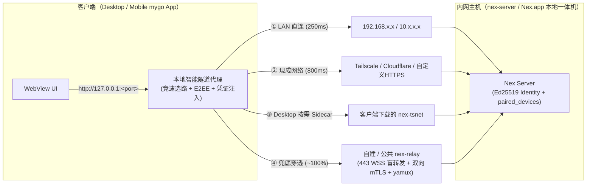

# Nex-v3 无公网 IP 远程访问与多通道互联技术规范 (Remote Access Spec)

- **状态**: Approved / Ready for Incremental Delivery
- **更新日期**: 2026-11-22
- **关联文档**:
  - [01-architecture-spec.md](./01-architecture-spec.md)
  - [02-client-and-protocol-spec.md](./02-client-and-protocol-spec.md)
  - [10-browser-use-spec.md](./10-browser-use-spec.md)
  - [11-mygo-client-guide.md](./11-mygo-client-guide.md)
- **设计目标**: 在无公网 IP、存在企业防火墙 / CGNAT 的网络环境下，以 **一人多终端（桌面 + 移动）远程接入内网 `nex-server` / 本地一体机 `Nex.app`** 为核心场景，构建一套 **“单一密码学主机身份 + 多通道自动竞速选路（LAN → 现成网络 / 按需 `nex-tsnet` → 自建 E2EE `nex-relay`）+ 扫码配对与设备吊销”** 的纯 Go（`CGO_ENABLED=0`）远程访问体系。

---

## 1. 背景、核心约束与路线定位

### 1.1 硬约束
1. **无集中账号平台**：一人多终端自托管产品不应强依赖中心化注册登录或云端托管密钥；所有设备信任关系均存储在内网 `nex-server` 本地 SQLite（`main.db`）与客户端原生系统钥匙串（`mygo.Secrets`）中。
2. **纯 Go 零 CGO 与包体克制**：
   - `nex-server`、`nex-runner`、`nex-relay` 与 `nex-app` 桌面端必须严格保持 `CGO_ENABLED=0` 交叉编译（`darwin/arm64`、`linux/amd64`、`windows/amd64`）。
   - **禁止将 ~20MB 的 `tsnet`（Tailscale 协议栈）硬编码进主程序或移动端二进制**；移动端安装包需保持轻量，服务端和桌面端采用与 Browser Use `chrome-headless-shell` 同构的 **按需下载 Sidecar（`nex-tsnet`）** 模型。
3. **传输入口单一、前端零入侵**：
   - `clients/web`（以及打包进 `mygo` WebView 的同一套前端产物）仅通过统一的 `resolveApiBase()` / `resolveWsUrl()` 访问唯一 HTTP + WebSocket 入口（`/api/v1/*` + `/ws/client`）。
   - `mygo` 客户端自带 Go `HostService`，只需在本地起一个只监听 `127.0.0.1:<随机端口>` 的智能隧道代理，前端无需重写业务协议即可享受到 **端到端加密（E2EE）、多通道切换与断线自动恢复**。
4. **移动平台沙盒约束（iOS / Android）**：
   - iOS 代码签名与 Android API 29+ SELinux `W^X` 策略禁止 App 在运行时下载并执行外部二进制文件（即手机端无法拉起 `nex-tsnet` 子进程）。
   - 因此手机端遵循：**同 Wi-Fi LAN 直连 → 手机若开启系统级 Tailscale / 自定义公网入口直连 → 无感自动回落至 `nex-relay` 443 WSS + mTLS 加密隧道**，确保任何网络下 **~100% 连通率**。

### 1.2 访问端范围与后续 Web 支持路线

- **Phase 1（当前主线）**：优先支持 `mygo` 桌面端（macOS / Linux / Windows）与移动端（iOS / Android）通过加密隧道访问内网主机。
- **Phase 2（纯 Web 浏览器支持路径，三档演进）**：
  1. **档位 1 — 现成网络（零改动立即可用）**：通过 Tailscale MagicDNS / Cloudflare Tunnel / `frp` 暴露 HTTPS 入口时，任意浏览器均可直接打开。
  2. **档位 2 — 私有 `nex-relay` 终结 HTTPS**：在自控 VPS 上为 `nex-relay` 配置通配符域名与 TLS（`*.tunnel.example.com`），Relay 终结浏览器 HTTPS/WSS 后转入对应内网隧道（前端零改动；适合可信自建 Relay）。
  3. **档位 3 — 公共不可信 Relay 下的纯 Web E2EE**：前端引入 `EncryptedWSTransport` + WebCrypto（X25519 + AES-GCM）+ IndexedDB 设备密钥 + Service Worker/Blob 代理（仅在运营开放式公共零信任中继且必须免装客户端时投入）。

---

## 2. 总体架构与多通道自动选路

### 2.1 一主多路统一模型

一台内网主机只拥有 **一个密码学身份（`NodeID` + `Ed25519` 身份证书公钥）**，但可同时发布多条可达路径；客户端配对一次即可在全网环境中无缝漫游：



### 2.2 客户端通道优先级与竞速策略

客户端在建立或重连托管主机连接时，按 **延迟最低、信任边界最小** 原则并发/阶梯探测：

| 优先级 | 通道标识 | 触发条件与目标 | 安全模型 | 适用平台 |
| :---: | :--- | :--- | :--- | :--- |
| **1** | `lan` | 探测配对记录中的内网 IP 端口（超时 **250ms**） | HTTP(S) + Per-Device Token（局域网直连可选 TLS） | Desktop + Mobile |
| **2** | `direct` | 探测自定义入口 / Cloudflare Tunnel / 系统 Tailscale IP 与 `*.ts.net`（超时 **800ms**） | HTTPS / WireGuard + Per-Device Token | Desktop + Mobile |
| **3** | `tsnet_client` | 上述直连失败且本机已安装 `nex-tsnet` 客户端 Sidecar（超时 **4s**） | Tailscale WireGuard E2EE + Per-Device Token | **仅 Desktop** |
| **4** | `relay` | 以上均不可达时兜底连接 `nex-relay`（443 WSS） | **零信任双向 mTLS（钉死双方 Ed25519 公钥）+ `yamux` 多路复用** | Desktop + Mobile |

> 客户端本地代理记录当前选中的 `active_transport`（`lan` | `direct` | `tsnet_client` | `relay`）并暴露给前端状态栏徽标；移动端从 Wi-Fi 切到 5G 时，由 `mygo.App.OnDidBecomeActive` / `mygo.Power.OnResume` 触发通道重测与 WS `last_seen_seq` 续传。

---

## 3. 零信任身份体系、配对流程与跨端扫码

### 3.1 密码学身份（Host & Client）
- **密钥算法**：统一使用 Go 标准库 `crypto/ed25519` 生成持久化密钥对，并签发有效期 10 年的 X.509 自签证书（TLS 握手时**不校验 CA**，严格校验证书公钥的 SHA-256 指纹 `fp`）。
- **主机标识（`NodeID`）**：由主机 Ed25519 公钥派生：`nex_` + `base32_nopad(sha256(pubKey))` 小写前 24 位（例：`nex_k7m2p9x4q1v8n5r3t6w0y2z4`）。
- **指纹展示（`server_pubkey_fp`）**：完整 SHA-256 十六进制或 Base64URL 指纹，写入二维码并在连接失败时做防 MITM 比对。
- **存储位置**：
  - 服务端：`<dataDir>/remote_identity.json`（权限 `0600`）+ `main.db` 新增 `paired_devices` 表。
  - 客户端：设备私钥与每台主机的凭证存入 `mygo.Secrets`（macOS Keychain / Windows Credential Manager / Linux Secret Service / iOS Keychain / Android Keystore，支持私有目录 fallback）。

### 3.2 `paired_devices` 数据模型

```sql
CREATE TABLE IF NOT EXISTS paired_devices (
    id              TEXT PRIMARY KEY,          -- "dev_<uuid>"
    name            TEXT NOT NULL,             -- 设备名称，如 "iPhone 16 Pro"
    platform        TEXT NOT NULL,             -- "ios" | "android" | "darwin" | "linux" | "win32"
    pubkey_fp       TEXT NOT NULL UNIQUE,      -- 客户端 Ed25519 公钥 SHA-256 指纹
    pubkey_pem      TEXT NOT NULL,             -- 客户端证书/公钥（供 mTLS VerifyPeerCertificate）
    token_hash      TEXT NOT NULL,             -- Per-device bearer token 的 SHA-256（供 LAN/Direct 路径认证）
    created_at      INTEGER NOT NULL,
    last_seen_at    INTEGER NOT NULL DEFAULT 0,
    last_transport  TEXT NOT NULL DEFAULT '',
    revoked_at      INTEGER NOT NULL DEFAULT 0 -- >0 表示已吊销
);
```

### 3.3 一次性配对码与二维码格式

內网主机生成有效期 **5 分钟、单次有效** 的随机 `pair_token`（32 字节高熵随机串，仅存于服务端内存或加密表），拼装为紧凑 `nex://` URI 渲染二维码：

```text
nex://pair?v=1&node=nex_k7m2...&fp=<base64url>&name=MacBook%20Pro&token=<pair_token>&relay=https%3A%2F%2Fnex.tylinux.cn&direct=https%3A%2F%2Fmac.tailnet.ts.net&lan=http%3A%2F%2F192.168.1.20%3A8080
```

- **配对交换流程**：
  1. 客户端扫码或粘贴配对码（或系统相机扫二维码经 `nex://pair?...` Deep Link 唤起 App）。
  2. 客户端若尚无设备密钥，自动生成自己的 `Ed25519` 身份证书。
  3. 客户端按通道竞速连通内网主机，调用公开端点 `POST /api/v1/remote/pair/complete`，提交 `{ pair_token, device_name, platform, client_pubkey_pem }`。
  4. **信任绑定校验**：
     - 走 `relay` 通道时，客户端在 TLS `VerifyPeerCertificate` 中严格验证服务端证书公钥 == 二维码中的 `fp`；
     - 服务端校验 `pair_token` 未过期且未使用，写入 `paired_devices` 并返回一次性颁发的 `{ device_id, device_token, server_info }`。
  5. 以后每次访问：
     - 走 `relay`（mTLS）：内网 `nex-server` 在 `VerifyPeerCertificate` 中查 `paired_devices` 确保证书公钥存在且 `revoked_at == 0`；**吊销设备会立即触发关闭该设备正在运行的全部活跃 `yamux` 隧道**。
     - 走 `lan` / `direct` / `tsnet`：客户端本地代理自动在请求头附带 `X-Nex-Device-Token: <device_token>`，即使服务端未开启 Web 密码或改过 Web 密码，**已配对设备凭证独立鉴权并支持按设备粒度随时吊销**。

### 3.4 跨五端扫码实现策略（基于 `mygo@v0.10.0`）

`mygo@v0.10.0` 已在桌面与移动端（`WKWebView` / `WebView2` / `WebKitGTK` / iOS `AVFoundation` 桥接 / Android WebChromeClient）支持 `mygo.PermissionCamera` 与权限回调。设计 3 层零死角扫码方案：
1. **原生授权声明**：
   - 宿主窗口通过 `SetPermissionHandler` 对可信页面授予 `mygo.PermissionCamera`。
   - [mygo.json](file:///Users/tylinux/Developer/Projects/Nex-v3/mygo.json) 中补充 `macos.infoPlist.NSCameraUsageDescription`、`ios.infoPlist.NSCameraUsageDescription` 与 `android.permissions: ["CAMERA"]`。
2. **App 内相机扫码**：
   - 前端扫码弹窗调用 `navigator.mediaDevices.getUserMedia({ video: { facingMode: 'environment' } })`；优先使用浏览器原生 `BarcodeDetector({ formats: ['qr_code'] })`，不支持的 WebView（如部分 `WKWebView`/Linux `WebKitGTK`）回退至轻量纯 JS 解码库（如 `jsQR`）。
3. **截图识别 & 系统相机兜底**：
   - 提供「从相册/图片识别二维码」（`<input type="file" accept="image/*">` 或粘贴截图到 `<canvas>` 解码）与「粘贴 `nex://pair?...` 文本」按钮，无摄像头桌面设备也可 1 秒配对。
   - iOS/Android/macOS 注册的 `nex://` URL Scheme 已原生支持由系统相机扫码直接拉起 Nex App 并触发配对弹窗。

---

## 4. 无状态盲转发中继协议（`pkg/relay` & `cmd/nex-relay`）

### 4.1 设计原则
- **零信任与无状态**：`nex-relay` **不保存用户消息、不解密任何流量、不依赖数据库**，可部署于任意 1C1G 公网 VPS 或容器。
- **双部署形态**：
  1. **独立二进制**：`cmd/nex-relay`（`-addr :8443`、`-token` 可选私有访问令牌）。
  2. **寄生内置模式**：给 `nex-server` 增加 `-enable-relay`（环境变量 `NEX_ENABLE_RELAY=true`），直接将 `/relay/v1/*` 挂载到现有公网服务（如 `https://nex.tylinux.cn/relay/v1/*`），并豁免 Web 密码中间件拦截，无需额外域名与服务器即可运行私有 Relay。

### 4.2 协议端点与时序

```text
内网 nex-server                              nex-relay (公网 443)                         客户端 mygo App
       │                                              │                                         │
       ├── 1. WS GET /relay/v1/host?node_id=nex_... ─►│ (登记活跃主机控制通道 + 心跳 KeepAlive)   │
       │◄─    {"op":"registered"} ────────────────────┤                                         │
       │                                              │                                         │
       │                                              │◄─ 2. WS GET /relay/v1/connect?node_id=..┤
       │                                              │    (生成 pending session_id = rly_xxx)    │
       │◄─ 3. {"op":"accept","session_id":"rly_xxx"} ─┤                                         │
       │                                              │                                         │
       ├── 4. WS GET /relay/v1/accept?session_id=xxx ►│                                         │
       │                                              │                                         │
       │◄═══════════════ 5. 双向 WS Frame 盲转发管道 ══════════════════════════════════════════►│
       │   (上层运行：服务端 TLS ↔ 双向 mTLS 校验证书 ↔ hashicorp/yamux ↔ 本地 HTTP/WS 请求)    │
```

- **`GET /relay/v1/health`**：返回 `{"ok":true,"online_hosts":N,"active_tunnels":M,"auth_required":bool}`，无需鉴权，供客户端连接测活与控制台探测。
- **可选私有中继令牌**：配置 `AuthToken` 后，`/host`、`/connect`、`/accept` 通过常量时间比较校验 `Authorization: Bearer <token>` 或 `?token=<token>`。
- **单向连接防泄漏与配额**：限制 `MaxPendingPerHost`（默认 32）、`MaxTunnelsPerHost`（默认 64）及 `AcceptTimeout`（默认 15s）；断线时通过比对连接指针保证新重连主机不会被旧协程误删。
- **帧大小上限**：数据通道设置 `SetReadLimit(16 << 20)`（16 MiB），兼容文件预览、会话附件与 Browser Use JPEG 推流帧。

---

## 5. 现成网络与按需下载 `nex-tsnet` Sidecar

### 5.1 系统 Tailscale 优先探测
内网服务端与桌面端在启动及设置页探测时，首先检测本机是否已有正常在线的系统 `tailscale`：
- 执行 `tailscale status --json`（超时 2s）：若 `BackendState == "Running"` 且存在 `Self.TailscaleIPs` 或 `Self.DNSName`（MagicDNS）：
  - 直接将 `https://<DNSName>` / `http://<TailnetIP>:<port>` 纳入主机发布的 `direct_urls` 列表；
  - 无需额外登录、零多余进程开销。

### 5.2 按需下载微型 Sidecar：`extras/nex-tsnet`
当本机**未安装系统 Tailscale、无 root 安装系统守护进程权限、或希望独立使用自建 Headscale 控制面**时：
1. **独立子模块隔离依赖**：在仓库根目录创建独立模块 `extras/nex-tsnet/go.mod`（仅在构建发布 Sidecar 时引入 `tailscale.com/tsnet`，主 `go.mod` 零膨胀）。
2. **复用镜像可配下载机制**：与 `pkg/harness/browser/provision.go` 完全一致的 `Probe → Install(mirror) → Uninstall` API 与进度状态展示，产物下载存放于 `<dataDir>/bin/nex-tsnet`。
3. **双角色运行模式**（兼容官方 Tailscale 与 Headscale `-control-url`）：
   - **Host Mode (`nex-tsnet host ...`)**：创建虚拟 Tailnet 节点并反向代理至本机 `127.0.0.1:<nexPort>`，通过 stdout JSON 行实时向 `nex-server` 吐出 `AuthURL`（供前端直接显示扫码登录二维码）、`TailnetIPs`、`MagicDNS` 与 `BackendState`。
   - **Client Proxy Mode (`nex-tsnet dial ...`)**：桌面端无系统 Tailscale 时，在 `127.0.0.1:<port>` 监听本地代理，通过用户态 `tsnet.Server.Dial` 直连对端主机的 Tailnet IP / MagicDNS。
4. **明确不强求移动端**：设置 UI 与客户端逻辑明确识别 `platform === 'ios' || platform === 'android'`，移动端隐藏下载按钮并提示“若未开启系统 Tailscale App，将自动使用端到端加密 Relay 通道”。

### 5.3 自定义直连入口（Cloudflare Tunnel / Headscale / frp）
在 **设置 → 远程访问** 中提供「自定义直连入口（Direct URLs）」列表（支持多个 URL，如 `https://my-mac.example.com`），会随宿主信息自动写入配对二维码的 `direct` 参数。Cloudflare Tunnel 用户只需把 `cloudflared tunnel --url http://127.0.0.1:8080` 生成的地址填入即可同时兼顾 App 直连与纯 Web 访问。

---

## 6. 稳定性与体验优化

1. **桌面防休眠**：`Nex.app` 作为本地一体机并开启远程访问时，若存在状态为 `running` 的活跃 Agent 会话或未决人工接管/提问，自动持有一个轻量防休眠锁（macOS `caffeinate -i -w <pid>` / Windows `SetThreadExecutionState` / Linux DBus ScreenSaver Inhibit），任务结束立即释放。
2. **Relay 模式带宽自适应**：隧道代理暴露 `active_transport`；当处于 `relay` 通道且未手动指定画质时，Browser Use `browser.control` 自动采用温和的 JPEG 压缩与宽度上限（如 `quality=60, max_width=960`），切回 `lan` 后自动恢复高画质。
3. **弱网 / 切网无缝接续**：客户端本地代理在底层连接断开后保持 HTTP 长连接快速重拨，配合 `/ws/client` 既有的 `client.subscribe(last_seen_seq)` 无缝补齐断线期间遗漏的流式事件。

---

## 7. 渐进式交付路线图（F1 → F5）

| 阶段 | 功能范围 | 核心产物 | 验收标准 |
| :---: | :--- | :--- | :--- |
| **F1** | **无状态盲转发中继** | `pkg/relay`、`cmd/nex-relay`、`nex-server -enable-relay` | 单测验证多隧道并发盲转发 >256KB 数据、Token 鉴权、掉线清理；`CGO_ENABLED=0` 三端可编译 |
| **F2** | **主机/设备密钥身份 + mTLS/`yamux` E2EE 隧道 + SQLite 配对与吊销** | `pkg/remote`、`pkg/store` (`paired_devices`)、`pkg/server` (`/api/v1/remote/*`) | 单元测试验证配对、指纹钉死拦截伪造中继、吊销后活跃隧道立即断开 |
| **F3** | **客户端本地 `127.0.0.1` 自动选路代理 + 跨五端 `HostService` 集成** | `clients/app/remote_proxy.go`、`clients/app/host.go`、`mygo.gen.ts`、`mygo.json`（相机权限） | Go 单测验证 LAN → Direct → Relay 自动切换、本地 proxy 无感转发 HTTP + WS + 二进制流 |
| **F4** | **前端远程访问设置页、设备管理、App 扫码 & 相册/DeepLink 配对 UI** | `SettingsRemoteAccess.tsx`、`QRPairModal.tsx`、`ServerConnectGate.tsx` 更新 | Vitest 验证配对流、设备列表/吊销、二维码渲染/文本解析、通道状态显示；真机可端到端连入 |
| **F5** | **现成网络探测 + 按需下载 `extras/nex-tsnet` Sidecar + 防休眠与画质自适应** | `extras/nex-tsnet`、Tailscale 探测与 Sidecar 管理器、Release/CI 脚本 | 验证系统 Tailscale 优先探测、离线回退至托管 `nex-tsnet` / `nex-relay`，三端无 CGO 编译通过 |
