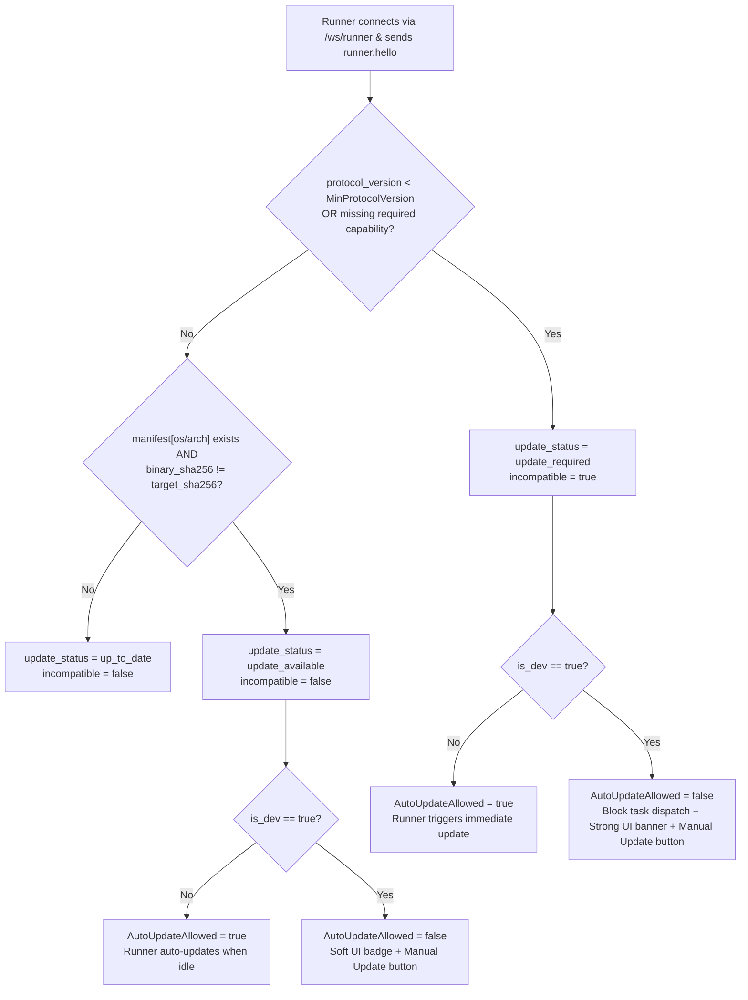

# Nex-v3 远程 Runner 自更新、兼容性分级与 Windows 托盘 / UAC 技术规范

- **状态**: Approved / Ready for Implementation (Checkpoint Spec)
- **更新日期**: 2026-11-24
- **Worktree / 分支**: `/Users/tylinux/Developer/Projects/Nex-v3-wt-runner-update` (`feat/runner-self-update`)
- **关联文档**:
  - [01-architecture-spec.md](./01-architecture-spec.md)
  - [02-client-and-protocol-spec.md](./02-client-and-protocol-spec.md)
  - [07-remote-terminal-and-workspace-spec.md](./07-remote-terminal-and-workspace-spec.md)
  - [12-remote-access-spec.md](./12-remote-access-spec.md)
- **设计目标**: 解决 `nex-server` 持续更新后内网/远程 `nex-runner`（Linux / macOS / Windows）版本滞后导致能力失效或协议不兼容的问题，建立一套 **“精确版本与兼容性分级裁决 + 优先 Release / Server 兜底分发 + 空闲自动升级与手动触发 + 原子替换与失联回滚 + Windows 系统托盘与按需 UAC 提权”** 的纯 Go（`CGO_ENABLED=0`）机制。

---

## 1. 背景、核心约束与已确认决策

### 1.1 问题分类
1. **静默失效 / 请求超时（`update_available` 或缺失新能力）**：Server 与 Web 端上线了新工具、新事件或新控制帧（如 `browser.probe`、`ask_user_question` 结构化选项、`session.rewind` 等），旧 Runner 不识别新字段或新帧类型，导致前端请求卡住或行为退化。
2. **协议不兼容（`update_required`）**：`runner.protocol_version < server.min_runner_protocol_version` 或缺失当前 Server 强制依赖的核心能力（`required_capabilities`），继续派发任务必然报错或损坏状态。
3. **Windows 权限与可观测性问题**：Windows 下 `nex-runner` 以普通用户前台控制台运行时，不仅会弹出黑色控制台窗口，且涉及受保护目录、服务控制、全局工具链/环境安装、系统级进程操作时易因权限不足失败。

### 1.2 核心约束与已拍板策略
1. **严格纯 Go 零 CGO**：所有二进制（`nex-server`、`nex-runner`、`nex-relay`、`nex-app`）必须严格保持 `CGO_ENABLED=0` 跨平台编译（`linux/amd64`、`linux/arm64`、`darwin/arm64`、`darwin/amd64`、`windows/amd64`）；Windows 托盘、UAC 与计划任务全部使用 `golang.org/x/sys/windows` 与系统 DLL（`user32.dll` / `shell32.dll` / `kernel32.dll`）动态调用实现，不引入任何 C 库或第三方重型 GUI 依赖。
2. **升级触发策略 — 空闲自动升级 + 手动升级保留**：
   - 正式发布的 Runner：协议兼容且有新版时（`update_available`），在无活跃会话/PTY/浏览器会话时**自动触发**；若当前忙碌则自动进入排空队列或待空闲后执行。协议不兼容时（`update_required`），握手后**立即强制升级**。
   - **始终保留手动升级能力**：无论自动或 `dev` 模式，Settings -> Runners 均保留单个 Runner「升级 / 立即升级」按钮与顶部「全部升级」按钮；Windows 托盘右键菜单也保留手动检查/升级入口。
3. **下载源策略 — 优先 Release，Server 本地兜底**：
   - Server 下发 `download_urls[]` 有序列表：若能匹配到官方 Release 资产，则 `[release_asset_url, server_fallback_url]`（优先走 Release 减轻 Server 带宽）；若 Server 运行在比最新 Release 更新的滚动版本、或内网 Runner 无法直连公网 Release，则自动无感回落到 Server 托管的 `/api/v1/runners/binary/{os}/{arch}`。
4. **开发态（`dev`）保护与双级别 UI 提示**：
   - `dev` 构建自动关闭静默自更新，避免本地调试二进制被线上覆盖。
   - 即使为 `dev` 模式，UI 仍需明确区分两级提示并支持点击一键升级：
     - **建议升级（`update_available`）**：温和徽章提示“有可用更新”+ 手动升级按钮；
     - **强提示升级（`update_required`）**：协议或必需能力不满足时，Server 拒绝向其派发普通任务（**但保持 WS 连接不断开以便接收升级指令**），并在 Settings -> Runners 与选用该 Runner 的工作区顶部展示醒目强提示横幅 + 一键「立即升级」。
5. **Windows 托盘与默认运行时 UAC**：
   - 不使用写死在 exe manifest 中的静态 `requireAdministrator`（避免 `--version` 冒烟校验、CLI 子命令或 `-no-elevate` 直接报错 `ERROR_ELEVATION_REQUIRED`）。
   - 采用**运行时按需 UAC 提权 + 纯 Go Win32 系统托盘 + Windows Task Scheduler 高权限免 UAC 开机自启**。

---

## 2. 协议与版本兼容性模型

### 2.1 `dev` 构建识别规则
以下任一条件满足即判定为 `is_dev = true`：
- `version == ""` 或 `version == "dev"`
- `strings.Contains(version, "-dev")`
- `strings.Contains(version, "-dirty")`

编译链路（`deploy.yml` / `build.yml` / `Makefile`）额外通过 `-ldflags` 注入：
- `main.version`：tag / `git describe --tags --always --dirty`
- `main.buildSHA`：精确 40 位或短 Git Commit SHA

### 2.2 握手与状态帧扩展（`pkg/protocol/frames.go`）

#### `RunnerHelloPayload`（Runner -> Server）
```go
type RunnerHelloPayload struct {
	RunnerID         string            `json:"runner_id"`
	Name             string            `json:"name"`
	Hostname         string            `json:"hostname"`
	OS               string            `json:"os"`
	Arch             string            `json:"arch"`
	Shell            string            `json:"shell"`
	Version          string            `json:"version"`
	BuildSHA         string            `json:"build_sha,omitempty"`
	BinarySHA256     string            `json:"binary_sha256,omitempty"`
	ProtocolVersion  int               `json:"protocol_version,omitempty"`
	Capabilities     []string          `json:"capabilities,omitempty"`
	IsDev            bool              `json:"is_dev,omitempty"`
	Elevated         bool              `json:"elevated,omitempty"`
	UpdateState      string            `json:"update_state,omitempty"`
	UpdateError      string            `json:"update_error,omitempty"`
	Tags             []string          `json:"tags,omitempty"`
	WorkspaceDefault string            `json:"workspace_default,omitempty"`
	AppliedConfigRev uint64            `json:"applied_config_rev"`
	Token            string            `json:"token,omitempty"`
	ActivePTYs       []PTYInfo         `json:"active_ptys,omitempty"`
}
```
- `BinarySHA256`：Runner 启动时对自身 `os.Executable()` 计算 SHA-256（启动计算一次并缓存）。
- `ProtocolVersion`：当前默认为 `protocol.ProtocolVersion`（如升级破坏性握手或必填字段时递增，同时 Server 维护 `MinRunnerProtocolVersion`）。
- `Capabilities`：Runner 声明自身能力集合，例如 `["self_update_v1", "ask_user_v2", "browser_v1", "win_tray_v1"]`。

#### `RunnerWelcomePayload`（Server -> Runner）
```go
type RunnerWelcomePayload struct {
	ServerVersion      string   `json:"server_version"`
	MinProtocolVersion int      `json:"min_protocol_version"`
	UpdateStatus       string   `json:"update_status"` // "up_to_date" | "update_available" | "update_required"
	UpdateReason       string   `json:"update_reason,omitempty"`
	TargetVersion      string   `json:"target_version,omitempty"`
	TargetBuildSHA     string   `json:"target_build_sha,omitempty"`
	TargetSHA256       string   `json:"target_sha256,omitempty"`
	DownloadURLs       []string `json:"download_urls,omitempty"`
	AutoUpdateAllowed  bool     `json:"auto_update_allowed"`
	Incompatible       bool     `json:"incompatible,omitempty"`
}
```

#### 新增控制帧
1. `TypeRunnerUpdate = "runner.update"`（Server -> Runner）：
   ```go
   type RunnerUpdatePayload struct {
   	RequestID      string   `json:"request_id"`
   	TargetVersion  string   `json:"target_version,omitempty"`
   	ExpectedSHA256 string   `json:"expected_sha256"`
   	DownloadURLs   []string `json:"download_urls"`
   	Mode           string   `json:"mode"` // "when_idle" | "immediate"
   	Force          bool     `json:"force,omitempty"` // dev 手动点升级时为 true
   }
   ```
2. `TypeRunnerUpdateStatus = "runner.update_status"`（Runner -> Server，Server 同步更新 `RunnerRecord` 并广播 `runner.status` 给所有前端）：
   ```go
   type RunnerUpdateStatusPayload struct {
   	RequestID     string `json:"request_id,omitempty"`
   	Phase         string `json:"phase"` // "idle" | "draining" | "downloading" | "verifying" | "installing" | "restarting" | "succeeded" | "failed" | "rolled_back"
   	ProgressPct   int    `json:"progress_pct,omitempty"`
   	TargetVersion string `json:"target_version,omitempty"`
   	Message       string `json:"message,omitempty"`
   	Error         string `json:"error,omitempty"`
   }
   ```

### 2.3 Server 裁决与兼容性门控规则



- **绝对禁止直接断开不兼容 Runner 的 WS 连接**：若在握手阶段 `426` / `Close` 拒绝连接，旧 Runner 永远收不到 `runner.update` 指令，只能人工 SSH 上去救。正确做法是**允许连接但标记 `incompatible = true`**：
  - `session.prompt` / `pty.open` / `skills.discover` 等业务请求若路由到 `incompatible` Runner，Server 立即返回清晰错误（`runner <name> requires upgrade to <target_version> before running tasks`）；
  - `runner.update`、心跳、状态同步始终保持畅通，保证一键升级能立刻拉起。
- **`RunnerRecord` 扩展字段**（[pkg/store/entities.go](file:///Users/tylinux/Developer/Projects/Nex-v3-wt-sidebar/pkg/store/entities.go) 与前端 [types.ts](file:///Users/tylinux/Developer/Projects/Nex-v3-wt-sidebar/clients/web/src/core/types.ts)）：
  - `build_sha`, `binary_sha256`, `protocol_version`, `is_dev`, `elevated`
  - `update_status` (`up_to_date` | `update_available` | `update_required`)
  - `update_reason`, `target_version`, `update_phase`, `update_progress`, `update_error`

---

## 3. 产物清单与“优先 Release、Server 兜底”分发机制

### 3.1 `manifest.json` 规范（`/opt/nex-v3/runners/manifest.json`）
由 CI（[deploy.yml](file:///Users/tylinux/Developer/Projects/Nex-v3-wt-sidebar/.gitea/workflows/deploy.yml) / [build.yml](file:///Users/tylinux/Developer/Projects/Nex-v3-wt-sidebar/.github/workflows/build.yml)）在构建多平台 `nex-runner` 后自动生成并随二进制一同部署：

```json
{
  "version": "0.1.3-dev+6baa831",
  "commit_sha": "6baa831...",
  "min_protocol_version": 1,
  "required_capabilities": ["self_update_v1"],
  "built_at": 1795452000000,
  "release_base_url": "https://github.com/<owner>/Nex-v3/releases/download/v0.1.3",
  "binaries": {
    "linux/amd64": {
      "filename": "nex-runner-linux-amd64",
      "sha256": "...",
      "size_bytes": 18432000
    },
    "darwin/arm64": {
      "filename": "nex-runner-darwin-arm64",
      "sha256": "...",
      "size_bytes": 17910000
    },
    "windows/amd64": {
      "filename": "nex-runner-windows-amd64.exe",
      "sha256": "...",
      "size_bytes": 18940000
    }
  }
}
```
若本地 `/opt/nex-v3/runners/` 存在二进制但缺少 `manifest.json`（兼容手工编译部署），Server 启动时自动扫描目录并计算对应 SHA-256 与文件大小作为内存清单。

### 3.2 Release 优先 + Server 兜底解析器（`pkg/server/runner_update.go`）
1. **Release 源配置**：支持环境变量/启动参数 `NEX_RELEASE_MANIFEST_URL`（或 `NEX_RELEASE_BASE_URL`），Server 后台按 TTL（5 分钟）拉取并缓存 Release `manifest.json` / `version.json`。
2. **下载 URL 排序决策**：
   - 若 Release 清单存在且目标平台条目的 `sha256`（或 `version`+`commit_sha`）与 Server 当前要求的目标一致（或 Release 版本更新且兼容）：
     `DownloadURLs = [ "<release_base_url>/nex-runner-<os>-<arch>[.exe]", "<server_public_or_ws_derived_http_origin>/api/v1/runners/binary/<os>/<arch>?token=<runner_token>" ]`
   - 若 Server 运行的是刚推送到 `main` 的最新代码（尚未打 Release Tag）或 Release 清单不可用：
     `DownloadURLs = [ "<server_http_origin>/api/v1/runners/binary/<os>/<arch>?token=<runner_token>" ]`
3. **Runner 侧连接地址推导**：Runner 自身总是知道自己连向哪个 `ServerWSURL`（`wss://host:port/ws/runner` -> `https://host:port`），Server 返回相对路径 `/api/v1/runners/binary/{os}/{arch}` 时，Runner 自动拼接 `ServerHTTPOrigin` 并携带 `Authorization: Bearer <token>` 请求头（支持内网反向代理与直连场景，无需公网域名也能兜底下载）。

### 3.3 Server HTTP 接口
- `GET /api/v1/runners/manifest`：返回当前 Server 托管的清单与各平台可用版本（需用户登录态）。
- `GET /api/v1/runners/binary/{os}/{arch}`：校验 Runner Pairing Token（`Authorization: Bearer ...` 或 `?token=...`）或已登录用户 Cookie，安全校验 `os`/`arch` 白名单后流式输出二进制，附带 `X-Binary-SHA256` 与 `Content-Length`。
- `POST /api/v1/runners/{id}/update`：触发指定 Runner 升级，Body：`{ "mode": "immediate" | "when_idle", "force": true }`（`force=true` 允许对 `dev` Runner 手动下发）。
- `POST /api/v1/runners/update-all`：一键为所有存在更新且非 `dev`（可选 `include_dev`）的在线 Runner 下发 `runner.update`。

---

## 4. Runner 自更新引擎、排空与自动回滚

实现文件：`pkg/runner/updater.go`、`pkg/runner/updater_unix.go`、`pkg/runner/updater_windows.go`。

### 4.1 状态机与任务排空（Drain）
1. **自动调度**：收到 `runner.welcome` 后：
   - 若 `IsDev == true`：不自动升级（仅记录可升级状态供托盘展示），等待来自 Server 的显式手动指令 `runner.update{Force: true}`。
   - 若 `AutoUpdateAllowed == true && UpdateStatus == "update_required"`：立即进入升级流程。
   - 若 `AutoUpdateAllowed == true && UpdateStatus == "update_available"`：触发 `when_idle` 模式升级。
2. **忙碌检测与 Drain**：
   - `Node` 统计当前活跃执行数：`activeTurns + activePTYs + activeBrowserSessions`。
   - 当 `Mode == "when_idle"` 且活跃数 > 0：Runner 进入 `draining` 状态，拒绝新的 `session.prompt`（或通知 Server 暂缓），等待活跃任务自然结束后立即开始下载与替换；同时上报 `phase = "draining"`。
   - 当 `Mode == "immediate"`（`update_required` 或用户在 UI 强制点击立即升级）：立刻中止等待并开始下载替换。
3. **单飞锁 & 冷却期**：同一时刻只允许一个更新 goroutine 运行；若最近同一 `ExpectedSHA256` 已回滚失败，设置退避冷却（5min -> 15min -> 60min），避免无限重启风暴。

### 4.2 多源下载与双重安全校验
1. 顺序遍历 `DownloadURLs`：
   - 对 HTTP/HTTPS 下载设置连接超时 `10s`、总超时 `120s`；按进度节流上报 `phase = "downloading"` + `progress_pct`。
   - 若 Release URL 返回非 200、超时或哈希不匹配，自动记录警告并无缝切换到下一个 URL（即 Server 兜底端点）。
2. 写入路径：必须写入当前 `os.Executable()` **所在同目录**下的 `<exe>.new`（保障后续 `os.Rename` 属于同一文件系统上的原子操作，避免 `EXDEV` 跨分区移动失败）。
3. **校验 1（SHA-256 强校验）**：流式计算下载文件 SHA-256，必须严格等于 `ExpectedSHA256`。
4. **校验 2（可执行冒烟校验）**：
   - Unix 上先 `chmod 0755 <exe>.new`；
   - 执行 `<exe>.new --version`（5 秒超时），确认退出码为 `0` 且输出非空，防止坏包、错误架构包或 Windows Defender/Gatekeeper 拦截直接导致进程失联。

### 4.3 跨平台原子替换与重启
- **Linux**（`updater_unix.go`）：
  1. `os.Rename(curExe, curExe+".bak")`
  2. `os.Rename(newExe, curExe)`
  3. 若当前以 `systemd` / 服务方式托管（或通过 `-exec-restart`），优先尝试 `syscall.Exec(curExe, os.Args, os.Environ())` 原地替换进程映像（保持 PID 不变）；失败则优雅退出交由服务管理器拉起。
- **macOS**（`updater_unix.go`）：
  1. 兼容独立二进制与 `NexRunner.app/Contents/MacOS/nex-runner`（沿用 [ssh_deploy.go](file:///Users/tylinux/Developer/Projects/Nex-v3-wt-sidebar/pkg/server/ssh_deploy.go#L969) 的 `.app` 封装以保留本地网络隐私授权）。
  2. `os.Rename(curExe, curExe+".bak")` -> `os.Rename(newExe, curExe)` -> `chmod 0755`。
  3. Best-effort 执行 `codesign --force --sign - <app_or_bin>`，随后 `syscall.Exec`（若由 `launchd` 托管且设置了 KeepAlive，也可退出由 `launchd` 拉起）。
- **Windows**（`updater_windows.go`）：
  - **关键限制**：Windows 禁止覆盖/删除正在运行的 `.exe`，但**允许对其重命名**。
  - 步骤：
    1. 若存在遗留 `curExe+".old"`，先尝试删除；
    2. `os.Rename(curExe, curExe+".old")`
    3. `os.Rename(newExe, curExe)`
    4. 启动新版：
       - 若运行在 Windows Service（SCM）下：拉起短命辅助子进程执行服务重启（或直接通知 SCM 触发恢复重启）；
       - 若交互桌面模式运行：使用 `CreateProcess`（隐藏窗口、`CREATE_NEW_PROCESS_GROUP`）拉起短命切换脚本/子进程（等待旧 PID 退出或延迟 1s 后启动 `<curExe> <原参数>`）；**关键点：由于旧进程已通过 UAC 提权，子进程会直接继承管理员令牌，不会再次弹出 UAC 提示框**。
    5. 旧进程释放端口/文件锁并立即退出。

### 4.4 健康确认与自动回滚（`~/.nex-runner/update_state.json`）
- 替换前持久化状态文件：
  ```json
  {
    "in_progress": true,
    "prev_version": "0.1.2",
    "target_version": "0.1.3",
    "target_sha256": "...",
    "backup_path": "/path/to/nex-runner.bak",
    "started_at": 1795452100000
  }
  ```
- 新进程启动流程：
  1. 若无异常并成功连上 Server 完成 `runner.hello` 握手：清除 `update_state.json` 中的 `in_progress`，异步清理 `.bak` / `.old`，并向 Server 发送 `runner.update_status{Phase: "succeeded"}`。
  2. **看门狗超时（30s）**：若启动后 `in_progress == true` 且超过 30 秒仍未能建立正常连接并完成握手（且存在可执行的 `backup_path`），自动将 `backup_path` 换回 `curExe` 并重新拉起旧版本，标记状态为 `rolled_back`；旧版连上 Server 后上报 `runner.update_status{Phase: "rolled_back", Error: "..."}`。

---

## 5. Windows 系统托盘、按需 UAC 提权与高权限开机自启

新增代码全部隔离在 `//go:build windows` 文件中（非 Windows 构建零影响）：
- `cmd/nex-runner/win_uac.go`（非 Windows 提供空实现 `win_stub.go`）
- `cmd/nex-runner/win_tray.go`
- `cmd/nex-runner/win_autostart.go`
- `cmd/nex-runner/tray_icon.ico`（内嵌 `//go:embed` 多尺寸 ICO 图标）

### 5.1 运行时按需 UAC 提权（`win_uac.go`）
- **新增 CLI 参数**：
  - `-no-elevate`：显式允许以当前普通用户权限运行（不弹 UAC）。
  - `-no-tray`：禁用系统托盘（例如纯命令行后台或容器脚本）。
  - `-elevated-child`（内部标志）：防止意外循环重入。
- **跳过提权的场景**：
  1. 短命 CLI 子命令：`--version` / `-version` / `version`、`service ...`、`autostart ...`、`-prompt ...`。
  2. 已传入 `-no-elevate` 或当前进程已处于 Windows Service Session 0（通过 `service.Interactive()` 判断）。
  3. 当前已经具备管理员令牌：`windows.GetCurrentProcessToken().IsElevated() == true`。
- **提权拉起流程**：
  - 调用 `shell32.dll` 的 `ShellExecuteW(0, "runas", exePath, reconstructedArgs, cwd, SW_HIDE)`。
  - 若用户点击「是」：新进程带管理员令牌启动，原进程直接 `os.Exit(0)`。
  - 若用户拒绝 UAC（返回 `ERROR_CANCELLED = 1223`）：打印清晰日志并退出（或若传了容错参数可按提示使用 `-no-elevate`）。
- **与自更新联动**：提权后的 `nex-runner.exe` 执行自更新重启新版本时，Windows `CreateProcess` 默认继承父进程 Token，因此**升级后免 UAC 直接保持管理员权限**。

### 5.2 纯 Go Win32 系统托盘（`win_tray.go`）
完全基于 `golang.org/x/sys/windows` 调用 `user32.dll` / `shell32.dll` / `kernel32.dll`（零 CGO）：
1. **控制台窗口管理**：进入托盘模式时若附加了继承控制台且非显式调试，调用 `kernel32.GetConsoleWindow()` + `user32.ShowWindow(hwnd, SW_HIDE)`（避免黑框常驻任务栏，同时日志完整写入 `~/.nex-runner/runner.log` 轮转文件）。
2. **托盘图标与悬停提示**：
   - 使用 `Shell_NotifyIconW`（`NIM_ADD` / `NIM_MODIFY` / `NIM_DELETE`）注册托盘图标，嵌入高对比度 `NexRunner` ICO。
   - 动态 Tooltip（上限 127 UTF-16 字符）实时展示：Runner 名、连接状态（`Connected` / `Reconnecting` / `Updating 45%` / `Update Required`）、版本号、权限标识（`[Admin]`）。
   - 支持系统气泡通知（`NIIF_INFO` / `NIIF_WARNING`）：当出现 `update_required` 或自更新成功/回滚时弹出提醒。
3. **右键上下文菜单（`CreatePopupMenu` + `TrackPopupMenuEx`）**：
   - `[状态行 - 禁用态]`：`NexRunner v0.1.3 [Admin] · Connected`
   - `检查 / 安装更新`（有更新时高亮提示 `发现新版本 -> 立即升级`）
   - `打开数据与日志目录`（`ShellExecuteW("open", dataDir)`）
   - `开机自动启动 (管理员免 UAC)`（带勾选态，点击安装/卸载计划任务）
   - `重启 Runner`
   - `退出`（清理托盘图标并优雅退出守护进程）

### 5.3 高权限免 UAC 开机自启（`win_autostart.go`）
为什么不用普通注册表 `HKCU\...\Run` 或 Windows Service：
- 注册表 `Run` 拉起的程序没有管理员权限，运行时会再度弹 UAC 框；
- Windows Service 跑在 Session 0 隔离区，无法渲染桌面系统托盘，也较难操作依赖用户桌面环境的 GUI/浏览器窗口。
- **Task Scheduler 计划任务方案**同时满足三者：
  - 新增子命令：`nex-runner autostart install|uninstall|status`
  - 内部调用 `schtasks.exe`（隐藏窗口执行）：
    `schtasks /Create /TN "NexRunner-<RunnerID>" /SC ONLOGON /RL HIGHEST /TR "\"<exePath>\" <savedFlags>" /F`
  - 用户登录后自动在桌面会话内以 **Highest（管理员权限）+ 有托盘 + 零 UAC 弹窗** 启动。

---

## 6. Web / Desktop / Mobile UI 与国际化

涉及文件：`clients/web/src/core/types.ts`、`clients/web/src/core/store.ts`、`clients/web/src/features/SettingsRunners.tsx`、`clients/web/src/features/ConversationPane.tsx`、`clients/web/src/i18n/locales/en-US.ts`、`clients/web/src/i18n/locales/zh-CN.ts`。

1. **Settings -> Runners 卡片升级**：
   - 显示版本芯片（例如 `v0.1.3`）+ 可选 `dev` / `Admin` 徽章。
   - **双级别状态区分**：
     - `update_available`（建议升级）：浅蓝/中性提示条（`可升级至 v0.1.4`；若是 `dev` 节点附带提示“开发版已关闭自动更新，可手动点击升级”）+「升级」按钮；
     - `update_required`（必须升级）：红色/琥珀色醒目警示条（展示服务端返回的 `update_reason`）+「立即升级」主按钮。
   - 实时进度展示：`排队排空中...` -> `下载中 62%...` -> `校验安装中...` -> `重启重连中...` / `已回滚（附错误）`。
   - 顶部工具栏增加「全部升级」按钮，一键升级所有可升级节点。
2. **工作区强提示与拦截**：
   - 当用户当前选中的 Runner 处于 `update_required`（不兼容）状态时，在聊天输入区上方显示紧凑但醒目的警告横幅：说明该 Runner 版本过低无法执行当前任务，并提供「立即升级」按钮与跳转 Runners 设置入口，禁用发送以免发出必挂请求。
3. **国际化键规划（必须保证 `en-US.ts` 与 `zh-CN.ts` 100% 键与占位符一致）**：
   - `runners.updateAvailableBadge`, `runners.updateRequiredBadge`, `runners.upToDateBadge`
   - `runners.devAutoUpdateDisabled`, `runners.updateNow`, `runners.updateAll`
   - `runners.updatePhase.draining`, `runners.updatePhase.downloading`, `runners.updatePhase.verifying`, `runners.updatePhase.installing`, `runners.updatePhase.restarting`, `runners.updatePhase.failed`, `runners.updatePhase.rolledBack`
   - `runners.incompatibleBannerTitle`, `runners.incompatibleBannerDesc`

---

## 7. 分阶段开发计划与验证矩阵

| 阶段 | 内容 | 主要改动范围 | 核心验收方式 |
| :--- | :--- | :--- | :--- |
| **F1** | 协议扩展、`dev` 检测与双级别兼容性裁决 | `pkg/protocol/frames.go`, `pkg/store/entities.go`, `pkg/runner/node.go`, `pkg/server/ws.go` | `go test ./pkg/protocol/... ./pkg/server/...` 验证 `up_to_date` / `update_available` / `update_required` 裁决及 `incompatible` 不断链拦截 |
| **F2** | `manifest.json`、Release 优先 + Server 兜底分发、CI 生成清单 | `pkg/server/runner_update.go`, `pkg/server/api.go`, `.gitea/workflows/deploy.yml`, `.github/workflows/build.yml` | 单测覆盖 Release 优先排序、Server 兜底、Token 鉴权下载、SHA-256 响应头 |
| **F3** | Runner 空闲自动升级、Drain 排空、跨平台原子替换与 30s 失败回滚 | `pkg/runner/updater*.go`, `cmd/nex-runner/main.go` | 单测 mock HTTP 下载 + 哈希/冒烟校验失败拒绝替换 + 超时自动回滚 `.bak` |
| **F4** | Windows 按需 UAC 提权、纯 Go Win32 托盘与高权限免 UAC 开机自启 | `cmd/nex-runner/win_*.go`, `cmd/nex-runner/tray_icon.ico` | `CGO_ENABLED=0 GOOS=windows GOARCH=amd64 go build ./cmd/nex-runner` 通过，覆盖命令行/非桌面跳过逻辑单测 |
| **F5** | Web/Desktop/Mobile Runners 设置 UI、工作区强提示拦截与 i18n | `clients/web/src/core/*`, `clients/web/src/features/SettingsRunners.tsx`, `ConversationPane.tsx`, `i18n/locales/*` | `tsc --noEmit` + `make test-web`（含 `i18n.test.ts` 与新增 Vitest 组件交互断言） |
| **F6** | 全量回归、跨平台构建校验（`verify-nocgo`）与 CI 部署验证 | 全仓库 | `make build && make test && make verify-nocgo` + 线上健康检查 |
