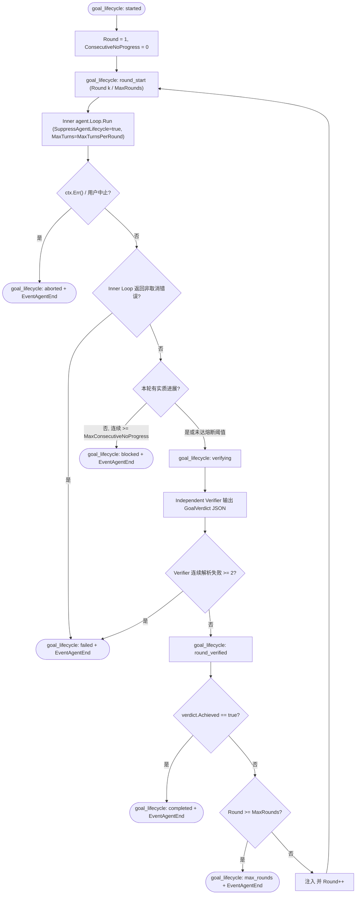

# 16. Goal Mode 自治闭环执行规范

- **状态**: Draft / Pending Review
- **更新日期**: 2026-11-26
- **关联文档**:
  - [01-architecture-spec.md](./01-architecture-spec.md)
  - [02-client-and-protocol-spec.md](./02-client-and-protocol-spec.md)
  - [03-agent-and-plugin-spec.md](./03-agent-and-plugin-spec.md)
  - [06-storage-and-observability-spec.md](./06-storage-and-observability-spec.md)
  - [09-project-status.md](./09-project-status.md)
- **设计目标**: 将 Nex-v3 的 `/goal` 从当前的“单轮 Prompt 包装 + 前端正则反推”升级为对齐 ZCode 的 Harness 级 `Plan → Execute → Independent Verify → Repeat / Wrap Up` 自治执行原语，同时严守纯 Go（`CGO_ENABLED=0`）+ TypeScript 架构与全链路端到端规范（Server 持久化、Runner `ConfigSnapshot` 同步、Settings UI 与自动化测试）。

---

## 1. 背景与现状差距分析

### 1.1 当前 Nex `/goal` 实现剖析

目前 Nex-v3 的 `/goal` 仅停留在 **Prompt 改写层 + 前端状态推测**：

1. **输入改写（[pkg/harness/prompts/goal.go](file:///Users/tylinux/Developer/Projects/Nex-v3/pkg/harness/prompts/goal.go) / [pkg/runner/execute.go](file:///Users/tylinux/Developer/Projects/Nex-v3/pkg/runner/execute.go)）**
   - `buildUserTurnText()` 调用 `prompts.ParseGoalCommand(raw)` 识别 `/goal ` 前缀，再由 `prompts.FormatGoalTurnPrompt(objective)` 把目标原文包进 `<system-reminder>` 与 `<untrusted_objective>`，口头要求模型使用 `todo_write` 并在结束前做一次自我 `Completion audit`。
2. **执行循环（[pkg/agent/loop.go](file:///Users/tylinux/Developer/Projects/Nex-v3/pkg/agent/loop.go)）**
   - 包装后的用户消息直接送入单次 `loop.Run(runCtx, &userMsg)`，Agent Loop 对 Goal 语义完全无感知：
     - 只要模型某一轮不再发起 Tool Call，Loop 立即退出并结束会话；
     - 达到默认 `MaxTurns = 40` 上限时，Loop 直接剥夺所有工具并发出收尾提示强制结束，导致复杂长任务中途截断。
3. **前端状态反推与渲染 Bug（[clients/web/src/core/reducer.ts](file:///Users/tylinux/Developer/Projects/Nex-v3/clients/web/src/core/reducer.ts) / [clients/web/src/features/ConversationStatusPanel.tsx](file:///Users/tylinux/Developer/Projects/Nex-v3/clients/web/src/features/ConversationStatusPanel.tsx)）**
   - `reducer.ts` 通过 `parseGoalTitle()` 从历史消息文本反推 `GoalEntry`；
   - `agent_end` 事件到达时，**不区分正常完成、报错（`p.error`）或用户手动中止，也不核对 `todos` 完成度，一律将 running 态 Goal 标记为 `completed`（绿勾）**；
   - `ConversationStatusPanel.tsx` 在 `activeGoal?.status === 'running'` 时渲染一个无交互的静态 `<Pause />` 图标，既不能反映真实执行阶段（执行中 vs 独立验证中），也无法点击中止。

### 1.2 与 ZCode Goal Mode 核心差距对比

| 维度 | Nex 当前实现 | ZCode Goal Mode（目标对齐态） |
| :--- | :--- | :--- |
| **架构层级** | **Prompt 层**：仅在用户消息外层包裹 `<system-reminder>` | **Harness 执行原语**：`Plan → Execute → Independent Verify → Repeat / Wrap Up` 外层自治循环 |
| **多轮推进机制** | **无**：模型停止调用工具即刻退出 | **外层 Round 状态机**：单轮结束后不直接退出，由独立验证结果决定自动续跑或收敛 |
| **完成度验证** | **同上下文自我审计**：容易将“改了代码”误判为“验证通过” | **独立 Verifier**：脱离主对话叙事，基于真实工具输出与交付物清单做结构化判定 |
| **未达标处理** | 直接结束或撞到 40 轮上限禁用工具退出 | 注入结构化缺口反馈（`missing_items` / `next_step`），自动启动下一轮修复 |
| **长上下文保活** | 触发 Auto-Compact 后首条目标易被摘要稀释 | 目标原文与轮次锚定在动态 `meta_context` 与压缩摘要提示中，不破坏 `core` prompt cache |
| **协议与 UI 状态** | 后端无状态、无事件；前端靠正则猜测，报错也标绿 | 专用 `goal_lifecycle` 持久事件 + 内联轮次分割条 + 状态面板真实进度与中止控制 |

---

## 2. 核心架构：Outer Goal State Machine（外层目标状态机）

### 2.1 状态流转总览

在 `pkg/agent` 中引入独立的外层目标编排器（`pkg/agent/goal.go`），将原来的单次 `loop.Run` 升级为受控的 `GoalRunner` 外层状态机：



### 2.2 单一外层生命周期原则（Single Outer Lifecycle）

为了保证 Web UI、桌面端与移动端流式状态、持久化回放以及 Status Panel 的一致性，必须严格遵守 **单一外层生命周期原则**：

- 在普通会话中，`agent.Loop.Run` 负责发射一对 `EventAgentStart` / `EventAgentEnd`；
- 在 Goal Mode 中，由外层 `GoalRunner` 负责发射**唯一一对** `EventAgentStart` 与 `EventAgentEnd`（以及中间各阶段的 `EventGoalLifecycle`）；
- `agent.LoopConfig` 新增字段：
  ```go
  SuppressAgentLifecycle bool
  ```
  当 `SuppressAgentLifecycle == true` 时，内层每轮 `agent.Loop.Run` **禁止发射** `EventAgentStart` 和 `EventAgentEnd`，其余事件（`turn_start` / `turn_end` / `message_*` / `tool_execution_*` / `compaction`）正常发射。
- **收益**：避免每轮结束时前端提前收口 `running = false`、避免状态面板闪烁或提前将 Goal 标为完成。

### 2.3 配置结构 `GoalConfig`（`pkg/agent/goal.go`）

```go
type GoalConfig struct {
	MaxRounds                int         // 默认 8，允许范围 1..30
	MaxTurnsPerRound         int         // 默认 40，允许范围 10..100
	MaxConsecutiveNoProgress int         // 默认 2，允许范围 1..5
	VerifierProvider         ai.Provider // 可选；nil 时复用当前会话 Provider
	VerifierModel            string      // 可选；空时复用当前会话 Model
}
```

### 2.4 单轮执行与预算隔离

- **每轮独立 Turn 预算**：内层每轮创建/配置独立的 `MaxTurns = GoalConfig.MaxTurnsPerRound`（通过 `LoopConfig.MaxTurns` 传入，共享并延续同一会话消息历史与 `Hooks` / `Store` / `Approver`）；
- **单轮上限不直接失败**：如果内层 Loop 触达 `MaxTurnsPerRound` 并按既定机制触发收尾总结退出，外层 `GoalRunner` **不直接结束整个 Goal**，而是照常进入 Stagnation 检测与 Independent Verifier，评估当前已完成部分并决定是否带着反馈开启下一轮继续推进。

### 2.5 无进展熔断（Stagnation Guard）

防止目标本身不可实现或环境阻塞时无限空转烧 Token：

- 外层统计每轮内层执行期间的**实质进展信号（Progress Signal）**，满足以下任意一项即判定本轮存在有效进展：
  1. 执行了至少一次**成功或有意义的非只读工具调用**（`!IsReadOnly` 且非因权限被拒）；
  2. `todo_write` 列表发生了结构变化（新增、状态推进或完成数增加）；
  3. 本轮产生了新的验证命令执行（如 `bash` 测试/构建命令）且输出相对上一轮发生变化。
- 若本轮无任何有效进展，则 `consecutiveNoProgress++`；否则清零。
- 当 `consecutiveNoProgress >= MaxConsecutiveNoProgress`（默认 2）时，直接终止循环并发射 `goal_lifecycle(phase="blocked")`，向用户输出明确阻塞原因与当前已尝试事项。

### 2.6 随时可控（Abort & Steer）

- **实时中止（Abort）**：用户点击停止按钮或调用 Session Abort 时，`runCtx` 被取消。无论是内层 `Loop.Run` 还是 `Independent Verifier` 的模型请求，均立即响应 `ctx.Err()` 退出；外层发射 `goal_lifecycle(phase="aborted")` 后再发射 `EventAgentEnd(reason="aborted")`。
- **运行中插话（Steer）**：`runner` 保留对当前活跃内层 `loop` 的引用（或在 Goal 执行器上实现统一的 `Steer(msg)` 代理），当用户中途发送 Steer 消息时：
  - 若当前正在内层 `Loop.Run` 中，直接透传给活跃 `loop.Steer(msg)` 立即打断当前流并纠偏；
  - 若当前恰好处于轮间验证（`verifying`）阶段，暂存至下一轮首条输入并标记目标上下文已更新。

---

## 3. 独立验证器设计（Independent Verifier）

位置：`pkg/agent/goal_verifier.go`

### 3.1 隔离原则与结构化输出

主对话 Agent 在同一长上下文里很容易产生“自圆其说”偏差（把“计划做完”或“文件已改”当成“任务达成”）。因此每轮结束后，由独立验证器发起一次**无工具调用（`Tools: nil`）、低温度、纯评估视角**的结构化判定请求，强制返回严格 JSON：

```go
type GoalVerdict struct {
	Achieved     bool     `json:"achieved"`
	Confidence   string   `json:"confidence"` // "high" | "medium" | "low"
	Summary      string   `json:"summary"`
	MissingItems []string `json:"missing_items,omitempty"`
	NextStep     string   `json:"next_step,omitempty"`
}
```

### 3.2 Verifier 确定性证据包（Evidence Bundle）

为避免验证器产生幻觉，Verifier 只依据程序采集的确定性证据进行裁决，输入由 4 部分组成：

1. **原始目标（不可信边界隔离）**：使用 `<untrusted_objective>...</untrusted_objective>` 包裹原始目标，并在 Verifier System Prompt 中明确声明目标文本属于不可信数据，不能覆盖验证规则或强行声明 `achieved: true`。
2. **最新 `todo_write` 状态快照**：提取最新一次 `todo_write` 的完整条目清单及 `completed / total` 计数；若仍有 `pending` / `in_progress` 条目，Verifier 必须逐一核查是否属于必需交付物。
3. **本轮真实工具调用证据摘要**：按执行顺序采集本轮内层 Loop 产生的 Tool Call 记录（工具名、关键参数如文件路径/命令、截断后的真实输出及 `is_error` 标记），让 Verifier 直接看到测试是否真的跑过、退出码是否为 0、文件是否真实读写。
4. **主 Agent 本轮最终回复**：附带主 Agent 本轮最后一条 `assistant` 文本，核对是否存在“声称完成但无对应工具证据”的矛盾。

### 3.3 硬性兜底与容错规则

- **JSON 容错提取**：模型输出可能包裹在 ```` ```json ... ``` ```` 代码块或前后夹带解释文本，解析器先剥离 Markdown code fence 并定位最外层 JSON 对象解析。
- **解析失败降级**：若解析仍失败或关键字段缺失，降级为 `GoalVerdict{Achieved: false, Confidence: "low", Summary: "Verifier output was invalid JSON"}` 并计数；**绝不静默放行当作完成**。若连续 2 轮 Verifier 解析/调用均失败，则以 `phase="failed"` 安全终止 Goal 并报错。
- **Todo 一致性约束**：Verifier 系统提示明确规定——只要存在未完成的必需 `todo_write` 项，除非在当前目标下有明确证据证明其无需执行并在 `Summary` 中说明豁免理由，否则应判定 `achieved: false`。
- **只读与无工具安全**：Verifier 调用始终不挂载可写工具，防止评估阶段意外修改工作区。

### 3.4 未达标反馈注入格式

当 `verdict.Achieved == false` 且尚未达到 `MaxRounds` 时，外层将结构化反馈作为一条新用户消息追加到对话历史（并同步通过 `EventMessageEnd` 持久化/广播或内部标记），驱动下一轮精准修复缺口：

```xml
<goal-verification-feedback round="1" max_rounds="8">
Independent verification determined the goal is NOT yet achieved.
Summary: Unit tests in pkg/agent pass, but the web UI build was not run and 1 todo item remains pending.
Missing items:
- Run `npm --prefix clients/web run build` and confirm zero TypeScript/Vite errors.
- Complete todo item: "Update zh-CN and en-US locale keys".
Recommended next step: Update the locale files, then run `npm --prefix clients/web test && npm --prefix clients/web run build`.
</goal-verification-feedback>
```

---

## 4. 上下文压缩与目标锚定保活（Compaction & Prompt Cache Safety）

### 4.1 严格保护 Prefix Prompt Cache

根据 [pkg/harness/prompts/builder.go](file:///Users/tylinux/Developer/Projects/Nex-v3/pkg/harness/prompts/builder.go) 的架构约定，`core` system section（`Name: "core"`, `CacheControl: true`）在同角色会话内必须保持逐字节稳定，以命中 Anthropic ephemeral / OpenAI Responses prefix cache。

因此，**绝不把活跃 Goal 写进 `core` section**，而是挂载到动态的 `meta_context` section（`Category: CategoryMetaContext`, `Name: "active_goal"`）：

- 每轮发起模型请求前，动态注入当前活跃 Goal 的摘要状态：
  - 目标原文（`<untrusted_objective>`）；
  - 当前进度（`Round k / MaxRounds`）；
  - 上一轮 Verifier 指出仍待解决的 `MissingItems`（如有）。

### 4.2 上下文压缩（Compaction）联动

在 [pkg/agent/compact.go](file:///Users/tylinux/Developer/Projects/Nex-v3/pkg/agent/compact.go) 中，无论触发 Tier 1 `MicrocompactMessages` 还是 Tier 2 `ShouldAutoCompact`（LLM 摘要压缩）：

- `compactionSystemPrompt` 的 `## Goal & Constraints` 段落需识别当前会话的活跃 Goal，明确要求摘要必须保留：
  1. 原始 Goal 目标与验收条件；
  2. 已验证通过的交付物及对应证据（命令/文件路径）；
  3. 尚未完成或上一轮 Verifier 指出的缺口。
- 结合动态 `active_goal` meta_context section，即便长任务经历多次 Auto-Compact，后续轮次依然不会丢失原始目标与验收标准。

---

## 5. 协议事件、持久化与配置同步（端到端数据流）

本节严格遵循 Nex-v3 “Server 持久化 + Runner `ConfigSnapshot` 同步 + REST API + Settings UI” 端到端约定，复用现有的 `store.UserPreferences` 与 `/api/v1/preferences` 通道，与 Memory / Browser / Multimodal 配置保持 100% 同构。

### 5.1 Agent 生命周期事件（`pkg/agent/events.go`）

参照 `EventCompaction` + `CompactionInfo` 的设计，新增 Goal 专用事件类型与载荷结构：

```go
const (
	EventGoalLifecycle EventType = "goal_lifecycle"
)

type GoalLifecycleInfo struct {
	GoalID       string   `json:"goal_id"`
	Phase        string   `json:"phase"` // "started" | "round_start" | "verifying" | "round_verified" | "completed" | "failed" | "aborted" | "max_rounds" | "blocked"
	Objective    string   `json:"objective,omitempty"`
	Round        int      `json:"round,omitempty"`
	MaxRounds    int      `json:"max_rounds,omitempty"`
	Achieved     *bool    `json:"achieved,omitempty"`
	Verdict      string   `json:"verdict,omitempty"`
	MissingItems []string `json:"missing_items,omitempty"`
	NextStep     string   `json:"next_step,omitempty"`
	Error        string   `json:"error,omitempty"`
}
```

在 `agent.Event` 结构体新增字段：

```go
Goal *GoalLifecycleInfo `json:"goal,omitempty"`
```

所有 `EventGoalLifecycle` 事件均通过现有 `recordAndEmitSessionEvent` 链路持久化到 SQLite `session_events` 表并实时推送给订阅客户端，天然支持断线重连（`last_seen_seq` 增量追平）与历史会话完整回放。

### 5.2 Store 持久化（`pkg/store/store.go`）

直接扩展 `store.UserPreferences`（持久化于 `kv_settings` 表 `user_preferences` key，并在 `DefaultUserPreferences()` 中提供默认值）：

```go
type UserPreferences struct {
	// ... 现有字段 ...
	GoalMaxRounds                int    `json:"goal_max_rounds"`
	GoalMaxTurnsPerRound         int    `json:"goal_max_turns_per_round"`
	GoalMaxConsecutiveNoProgress int    `json:"goal_max_consecutive_no_progress"`
	GoalVerifierProviderID       string `json:"goal_verifier_provider_id"`
	GoalVerifierModelID          string `json:"goal_verifier_model_id"`
}
```

默认值（`DefaultUserPreferences()`）：
- `GoalMaxRounds`: `8`（有效范围 `1..30`）
- `GoalMaxTurnsPerRound`: `40`（有效范围 `10..100`）
- `GoalMaxConsecutiveNoProgress`: `2`（有效范围 `1..5`）
- `GoalVerifierProviderID`: `""`（空表示复用当前会话 Provider）
- `GoalVerifierModelID`: `""`（空表示复用当前会话 Model）

### 5.3 Server REST API（`pkg/server/api.go`）

复用现有 `GET /api/v1/preferences` 与 `PUT /api/v1/preferences`（`handlePreferences`）：
- `PUT` 解码 `UserPreferences` 后，对 Goal 相关数值做范围校验/归一化（越界值钳位或返回 `400 Bad Request`，保持与现有参数校验风格一致）；
- 校验并保存后，调用现有的 `s.BroadcastConfigSync(r.Context())` 将最新配置广播给所有在线 Runner。

### 5.4 Runner 配置同步（`pkg/protocol/frames.go`, `pkg/server/server.go`, `pkg/runner/node.go`）

1. **`pkg/protocol/frames.go`**：新增 `GoalConfigSync` 并挂载到 `ConfigSnapshot`：
   ```go
   type GoalConfigSync struct {
   	MaxRounds                int    `json:"max_rounds,omitempty"`
   	MaxTurnsPerRound         int    `json:"max_turns_per_round,omitempty"`
   	MaxConsecutiveNoProgress int    `json:"max_consecutive_no_progress,omitempty"`
   	VerifierProviderID       string `json:"verifier_provider_id,omitempty"`
   	VerifierModelID          string `json:"verifier_model_id,omitempty"`
   }

   type ConfigSnapshot struct {
   	// ... 现有字段 ...
   	GoalSettings *GoalConfigSync `json:"goal_settings,omitempty"`
   }
   ```
2. **`pkg/server/server.go`**：在 `BuildConfigSnapshot()` 中从 `prefs` 填充 `GoalSettings`。
3. **`pkg/runner/node.go`**：在配置同步处理中读取 `snap.GoalSettings` 写入 Runner 内存配置（`n.goalCfg`），并在 `execute.go` 启动 `/goal` 会话时应用（含可选独立 Verifier Provider/Model 解析，若未配置或解析失败则安全回退到当前会话模型）。

---

## 6. Web UI、状态面板与 Settings UI 设计（`clients/web/src/`）

### 6.1 前端状态模型与 Reducer（`core/types.ts`, `core/reducer.ts`）

1. **扩展 `GoalEntry`（`clients/web/src/core/types.ts`）**：
   ```ts
   export type GoalPhase =
     | 'started'
     | 'round_start'
     | 'verifying'
     | 'round_verified'
     | 'completed'
     | 'failed'
     | 'aborted'
     | 'max_rounds'
     | 'blocked';

   export interface GoalEntry {
     id: string;
     index: number;
     title: string;
     status: 'running' | 'completed' | 'failed' | 'aborted' | 'blocked';
     phase?: GoalPhase;
     round?: number;
     maxRounds?: number;
     lastVerdict?: string;
     missingItems?: string[];
     error?: string;
     startedAt: number;
     completedAt?: number;
     completedTodos: number;
     totalTodos: number;
   }
   ```
2. **消费 `goal_lifecycle` 与修复 `agent_end` 状态误判（`clients/web/src/core/reducer.ts`）**：
   - 优先消费 `ev.type === 'goal_lifecycle'` 中的 `ev.payload.goal` 更新或创建 `GoalEntry`，精确映射 `phase` → `status`（`completed` → `'completed'`；`failed` / `max_rounds` → `'failed'`；`aborted` → `'aborted'`；`blocked` → `'blocked'`；其余运行态 → `'running'`）；
   - 保留 `parseGoalTitle()` 仅用于兼容未升级前产生、无 `goal_lifecycle` 事件的旧历史会话回放；
   - **修复 `agent_end` Bug**：当 `agent_end` 到达时，若存在仍为 `running` 的 Goal，检查 `p.reason` 与 `p.error`：
     - `p.reason === 'aborted'` → 标记为 `'aborted'`；
     - 存在 `p.error` 或 `p.reason === 'error'` → 标记为 `'failed'`；
     - 仅当未收到终态 `goal_lifecycle`（兼容旧会话）且无错误/中止时才回退标记为 `'completed'`。

### 6.2 对话流内联分割条（`ConversationPane.tsx`）

参照 Nex 现有的 ZCode 风格内联 Compaction 分割条，在对话消息流中插入紧凑的 Goal Round 分割指示器（可在 `ChatTurnItem` 中新增 `goalDivider` 卡片类型或同类轻量时间线节点）：

- `round_start`：`Goal · Round 2 / 8`
- `verifying`：`Goal · Round 2 / 8 · 正在独立验证...`（带运行态动效）
- `round_verified`（未达标）：`↻ 未达标（剩余 2 项）· 自动进入 Round 3`（可点击展开查看 `verdict` 与 `missing_items`）
- 终态：`✓ 目标已验证完成` / `⚠ 达到最大轮次上限` / `✕ 目标执行失败或已阻塞`

### 6.3 右上角状态面板（`ConversationStatusPanel.tsx`）

- 展示当前目标标题、实时计时与真实轮次标签（如 `Round 2/8`）；
- 运行态（`round_start` / `verifying`）使用与运行中任务一致的动态状态指示器（并区分“执行中”与“验证中”文案），**移除静态无意义的 `<Pause />` 图标**；
- 提供显式可点击的 **停止按钮（Square / Stop）**，点击触发 `abortActiveSession()`；
- 若最近一轮验证未通过或以 `failed` / `blocked` / `max_rounds` 结束，在面板内高亮显示 `lastVerdict` 与缺口条目数，区分成功绿勾、警告与错误图标。

### 6.4 Settings UI 与国际化（`SettingsPage.tsx`, `en-US.ts`, `zh-CN.ts`）

- 在 `SettingsPage.tsx`（常规/能力设置区块）新增 **Goal Mode（自治目标模式）** 配置卡片，支持配置：
  - 最大自治轮次（`goal_max_rounds`，默认 8）
  - 单轮最大执行步数（`goal_max_turns_per_round`，默认 40）
  - 连续无进展熔断阈值（`goal_max_consecutive_no_progress`，默认 2）
  - 独立验证模型（`goal_verifier_provider_id` / `goal_verifier_model_id`，默认“跟随当前会话模型”）
- **i18n 硬性约束**：所有界面文案必须同时写入 `clients/web/src/i18n/locales/en-US.ts` 与 `clients/web/src/i18n/locales/zh-CN.ts`，保持 100% key 与 `{placeholder}` 一致；严禁在组件内编写任何硬编码语言判断（`isZh` / `locale === 'zh-CN'` 等）。
- **样式前缀约束**：所有自定义 CSS 类、关键帧动画与 CSS 变量均使用 `nex-*` 前缀。

---

## 7. 分阶段实施与验证计划

### Phase 1：后端核心引擎（`pkg/agent` + `pkg/harness/prompts` + `pkg/runner`）
- **改动范围**：
  - `pkg/agent/events.go`：新增 `EventGoalLifecycle` 与 `GoalLifecycleInfo`；
  - `pkg/agent/loop.go`：新增 `LoopConfig.SuppressAgentLifecycle` 支持，并在退出/工具批次中暴露本轮工具执行与变更统计供外层做进展判定；
  - `pkg/agent/goal.go`：实现 `GoalConfig` 与 `GoalRunner` 外层状态机（多轮执行、单轮预算隔离、Stagnation 熔断、Abort/Steer 透传）；
  - `pkg/agent/goal_verifier.go`：实现独立 `GoalVerdict` 验证器、确定性证据包组装与 JSON 容错降级；
  - `pkg/agent/compact.go` 与 `pkg/harness/prompts/builder.go` / `goal.go`：支持活跃 Goal 动态 `meta_context` 锚定与压缩摘要保活；
  - `pkg/runner/execute.go`：识别 `/goal` 后调度 `GoalRunner` 而不是单次 `loop.Run`。
- **单测要求**：
  - 验证通过首轮即结束（`completed`）；
  - 验证未通过自动注入反馈并多轮续跑直至通过；
  - 单轮触及 `MaxTurnsPerRound` 后由 Verifier 接管并续跑下一轮；
  - 连续无进展达到阈值触发 `blocked` 熔断；
  - Verifier 非法 JSON 容错及连续失败退化为 `failed`；
  - 中途 `ctx.Cancel()` 触发 `aborted` 且只发射唯一一对 `EventAgentStart` / `EventAgentEnd`；
  - 触发 Auto-Compact 后目标约束依然保留。

### Phase 2：持久化、协议同步与 Server API（`pkg/store` + `pkg/protocol` + `pkg/server` + `pkg/runner`）
- **改动范围**：
  - `pkg/store/store.go`：扩展 `UserPreferences` 与 `DefaultUserPreferences()`；
  - `pkg/protocol/frames.go`：新增 `GoalConfigSync` 与 `ConfigSnapshot.GoalSettings`；
  - `pkg/server/api.go` & `pkg/server/server.go`：`handlePreferences` 参数校验、`BuildConfigSnapshot` 映射与 `BroadcastConfigSync`；
  - `pkg/runner/node.go`：接收并应用 `snap.GoalSettings`。
- **单测要求**：
  - `store_test.go` 读写默认与自定义 Goal 偏好；
  - `pkg/server` API 校验与 `ConfigSnapshot` 同步单测；
  - `pkg/runner` 端到端 `/goal` 执行与配置应用测试。

### Phase 3：前端状态、UI 交互与全量回归（`clients/web/src/`）
- **改动范围**：
  - `clients/web/src/core/types.ts` & `reducer.ts`：消费 `goal_lifecycle`、兼容旧会话、修复 `agent_end` 错误/中止状态误标；
  - `clients/web/src/features/ConversationPane.tsx`：内联 Goal Round 分割条与展开明细；
  - `clients/web/src/features/ConversationStatusPanel.tsx`：真实轮次、执行/验证阶段态、可点击停止按钮与终态区分图标；
  - `clients/web/src/features/SettingsPage.tsx` & `i18n/locales/{en-US,zh-CN}.ts`：Goal Mode 设置卡片与双语词条。
- **全量验证**：
  - `npm --prefix clients/web test`（含 `i18n.test.ts` 与 `workbench.test.tsx` 新增测试）
  - `npm --prefix clients/web run build`
  - `go test ./...`
