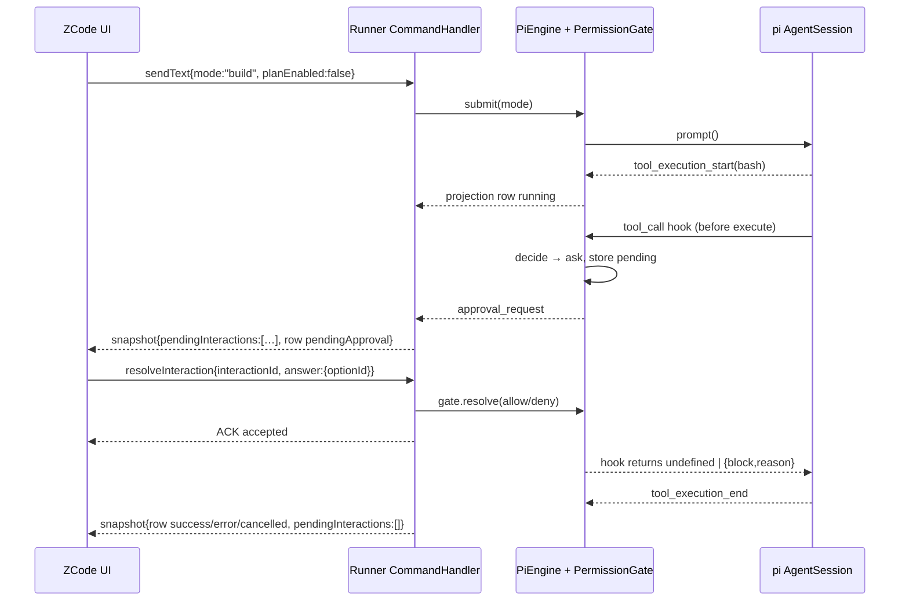

# Ask-before-changes permissions in next-runner

## 0. TL;DR

The unchanged UI already implements the entire approval UX from `ConversationSnapshot.pendingInteractions` + `toolCall.status = "pendingApproval"`. The runner only has to (a) emit those two facts while a `tool_call` extension hook is blocked, (b) implement `resolveInteraction`, and (c) honor `mode`/`planEnabled` from `createSession`/`sendText`. pi lets a `tool_call` handler await indefinitely and block with `{block:true, reason}`; abort resolves through `ctx.signal`, and no built-in timeout exists.

## 1. ZCode UI contract

### 1.1 Snapshot shape

`pendingInteractionSchema` — `/Users/tylinux/Developer/Projects/ZCode/packages/shared/src/nex-protocol-v4/snapshot.ts:310-350`:

- `interactionId: string` (card key / resolve key)
- `kind: "permission" | "userInput" | "workspaceHookReview"` (must equal `payload.kind`, superRefine at :324-331)
- `anchorRowId: number | null` (null = session-scoped; tool cards use the tool row)
- `createdAt`, optional `autoResolution` (omit)
- `payload`

`permissionRequestPayloadSchema` — `snapshot.ts:237-258`:

| field                | role in UI                                                                    |
| -------------------- | ----------------------------------------------------------------------------- |
| `toolCallId`         | correlates row/card                                                           |
| `toolName`           | card title / permission `kind`+`title` (`pendingInteractionAdapter.ts:79-80`) |
| `summary`            | human sentence; also scanned for a "reason" (`PermissionDialog.tsx:234-245`)  |
| `detail`             | raw tool input for the preview block (`pendingInteractionAdapter.ts:89-92`)   |
| `freeText?: boolean` | shows the feedback textarea; needed for deny-with-feedback                    |
| `display?`           | bounded preview (optional; omit for MVP)                                      |
| `origin?`            | subagent badge (omit)                                                         |
| `fullAccessOption?`  | "Full access" affordance; **omit** (see §2)                                   |
| `options[]`          | required, at least the three choices                                          |

Each option — `snapshot.ts:230-235`: `{optionId, label, kind: "allowOnce"|"allowAlways"|"deny"|"custom", response?: nexPermissionResponseSchema}`. UI sorts by kind (`packages/ui/src/lib/permissionRequest.ts:82-100`), derives labels/descriptions from `kind` unless `label` is non-generic (`PermissionDialog.tsx:744-773`), and special-cases the name `"Always allow in this session"` (`PermissionDialog.tsx:186-190`). `response` shape: `{decision: allow|deny|escalate|modify, reason?, modifiedInput?, permissionUpdates?: [{type:"addRules",behavior,rules:[{toolName,ruleContent?}]}]}` (`packages/shared/src/nex-protocol-legacy-types.ts:58-72`).

Tool row — `packages/shared/src/nex-protocol-v4/rows.ts:191-218`: `status` includes `"pendingApproval"` (:198) and `approvalInteractionId` "points at the pendingInteractions item" (:212-213). UI maps `pendingApproval` to a pending tool card (`packages/ui/src/v4/toolCallRowAdapter.ts:11-19`), counts it as running for turn grouping (`conversationTurnRenderUnits.ts:183-189`), and suppresses the loading bubble when such a row exists (`chatLoadingVisibility.ts:55-61`). A non-`workspaceHookReview` pending interaction hides (but does not unmount) the composer (`SessionPane.tsx:1098-1102`, `ConversationComposer.tsx:369-372,2007-2010`).

Rendering entry point: `V4InteractionDialogs.tsx:115-119` picks the first permission/userInput interaction; permission → `PermissionDialog` (:319-354); AskUserQuestion → `ElicitationDialog` (:357-409).

### 1.2 `resolveInteraction`

Command schema — `packages/shared/src/nex-protocol-v4/command.ts:176-188`:

```
payload: { interactionId, answer: {
  optionId?, freeText?,
  action?: "accept"|"decline"|"cancel",          // AskUserQuestion/plan only
  content?: Record<string, unknown>               // multi-question answers
}}
```

Envelope built by `createCommandEnvelope` (`packages/ui/src/v4/commandFactory.ts:52-71`): `{commandId: uuidv7, clientId, sessionId, type:"resolveInteraction", payload, issuedAt}`. Permission sends `{optionId, freeText?}` (`V4InteractionDialogs.tsx:339-352`). ACK accepted statuses are `accepted|duplicate|noop` (`V4InteractionDialogs.tsx:211-212`); `commandAckSchema` at `command.ts:430-444`. A typed result exists but is not required by this UI: `{type:"resolveInteraction", resolvedBy:{clientId, optionId?}}` (`command.ts:383-389`). Late answers must be idempotent-success (nex-cli behavior, `interaction-background.ts:33-58`).

The runner currently no-ops it: `/Users/tylinux/Developer/Projects/ZCode/packages/next-runner/src/v4/commands.ts:56-57`.

### 1.3 AskUserQuestion (shared mechanism, shape only)

`userInputRequestPayloadSchema` — `snapshot.ts:276-293`: `{kind:"userInput", prompt, freeText, options?, sensitive?, toolName?, toolCallId?, traceId?, input?, schema?, questions?: [{question,header,options:[{value,label,description?,preview?}],multiSelect?}], currentQuestionIndex?, answerDrafts?}`. Resolved with `{action, content}` (`V4InteractionDialogs.tsx:396-400`); pi has no such tool — it would need a custom tool plus the same pending map.

## 2. Permission mode

### 2.1 Values

`submissionModeSchema = ["build","edit","plan","yolo"]` — `packages/shared/src/nex-protocol-v4/submission.ts:4`. Display catalog: build = **"Ask before changes"**, edit = "Edit automatically", plan = "Plan mode", yolo = "Full access" (`packages/shared/src/nex-agent-model-state.ts:15-36`). `auto` is runtime-internal and never submitted. **Plan is a separate checkbox (`planEnabled`), not a permission mode** (`V4ComposerModeControls.tsx:143-145,188-213`); choosing plan stores `mode: "build"` + `planEnabled: true` (`useDraftConfigControl.ts:460-481`).

### 2.2 Transport

The selector only mutates the composer draft; no command is sent on click (`V4ComposerModeControls.tsx:40`, `SessionPane.tsx:3244-3250`). Mode rides the **next submission**:

- `createSession.firstInput.mode/planEnabled`, or `createSession.config.mode/planEnabled` for prewarm (`command.ts:30-41,46-57`; `SessionPane.tsx:2451-2457,2532`)
- `sendText.mode/planEnabled` (`command.ts:99-100`; `SessionPane.tsx:2585-2593`)

`createComposerSubmissionConfig` freezes it at submit and coerces `plan`→`build` with `planEnabled` (`packages/ui/src/v4/composer/composerSubmissionConfig.ts:26-43`). UI reads back only `snapshot.config.mode` to initialize the draft once (`useDraftConfigControl.ts:154-168`; snapshot `config.mode` at `session-config.ts:17`, default `"build"`; runner currently hardcodes `"build"` at `packages/next-runner/src/projection/snapshot.ts:61`). `switchCollaborationMode` exists (`command.ts:215-217`) but the composer does not use it; only legacy automation paths do (`packages/services/src/nex-agent/nexTaskServiceAdapter.ts:1180-1204`).

### 2.3 nex-cli policy (reference)

Decision order — `apps/nex-cli/packages/core/src/permission/service.ts:97-231`; build/edit/plan — `:450-530`; bash read-only classifier `bash-semantics.ts:39-75`; bash capability `bash.ts:76-95,470-479`; edit/write `edit.ts:274-282`, `write.ts:231-239`; read `read.ts:491-499`; MCP hints `packages/core/src/mcp/index.ts:127-140`.

Minimal table to implement:

| pi tool                     | build (ask)                              | edit          | yolo  | planEnabled                    |
| --------------------------- | ---------------------------------------- | ------------- | ----- | ------------------------------ |
| `read`,`grep`,`find`,`ls`   | allow                                    | allow         | allow | allow                          |
| `edit`,`write`              | ask                                      | allow         | allow | deny                           |
| `bash`                      | allow iff read-only classifier, else ask | same as build | allow | allow iff read-only, else deny |
| unknown/custom              | ask                                      | ask           | allow | deny                           |
| nested (`parentToolCallId`) | same table                               | same          | same  | same                           |

Bash classifier MVP: reject any of `| & ; > < $ \` ( )`or newline; first token must be in`{ls,cat,head,tail,pwd,rg,grep,find,wc,stat,file,echo,sed,sort,uniq,diff,which,git}`; for `git`allow only`status,diff,log,show,rev-parse`; otherwise ask. Reference richer classifier at `bash-semantics.ts:39`.

## 3. pi mechanics (1.3.0)

- **Block shape**: `ToolCallEventResult {block?: boolean; reason?: string; terminate?: boolean}` — `packages/coding-agent/src/core/extensions/types.ts:1454-1463`. Blocking produces an error tool result whose text is `reason` (`packages/agent/src/agent-loop.ts:744-751`).
- **Awaiting**: handlers are `async`, `ExtensionHandler<E,R> = (event,ctx) => Promise<R|void>|R|void` (`types.ts:1587`). `emitToolCall` does `await handler(...)` in a plain loop (`packages/coding-agent/src/core/extensions/runner.ts:1249-1267`). No timeout is applied anywhere; a handler can await for minutes. Slow handlers delay the turn (`docs/extensions.md:207`).
- **Event order**: `tool_execution_start` is emitted **before** `beforeToolCall` (`agent-loop.ts:542-547` sequential, `:591-598` parallel), then the hook, then execution, then `tool_execution_end`. So the runner sees the start event first and must transition the row to `pendingApproval` on the approval event.
- **Abort**: `ctx.signal` is the run's `AbortSignal` (`types.ts:351-354`; wired from `agent.signal` at `agent-session.ts:3471`). `session.abort()` aborts it and waits for idle (`agent-session.ts:2464-2474`; `agent.ts:341-343`). After the hook resolves, the loop checks `signal.aborted` and returns `"Operation aborted"` (`agent-loop.ts:737-743`). A blocked hook therefore cannot hang a stop, provided it races its own promise against the signal.
- **Nested calls**: `ctx.executeTool()` runs through `runToolCall` → `beforeToolCall` with `parentToolCallId` (`agent-session.ts:740-757`; `agent-loop.ts:800-812`; `types.ts:188-193,383-394`). Nested calls also pass through `tool_call`; gate them too.
- **Ordering**: handlers run in extension load order, then registration order; the first `block` short-circuits (`runner.ts:1253-1262`; `docs/extensions.md:180`). Inline `extensionFactories` load **after** path extensions and are appended (`resource-loader.ts:705-707,775-787`); a disk extension loaded earlier can block before us (more restrictive, acceptable) and can mutate `event.input` before us.
- **Registration**: `new DefaultResourceLoader({cwd, agentDir, settingsManager, extensionFactories:[{name:"nex-permission-gate", factory}]})`, `await loader.reload()`, then `createAgentSession({resourceLoader: loader, ...})` (`resource-loader.ts:285,325,1138-1166`; `sdk.ts:191-206` — a supplied loader is _not_ reloaded by the SDK, so reload yourself). `InlineExtension` type: `types.ts:2045-2075`.
- **Tool names/args**: `bash {command, timeout?}` (`tools/bash.ts:41-44`, name :418); `edit {path, edits:[{oldText,newText}]}` (`tools/edit.ts:32-41`, name :149); `write {path, content}` (`tools/write.ts:11-14`, name :50); `read {path, offset?, limit?}` (`tools/read.ts:13-17`, name :94).

## 4. Runner design

### 4.1 State ownership

- `PermissionGate` per open session, owned by `PiEngine.OpenSession` (`packages/next-runner/src/engine/pi/piEngine.ts:33-39`), created alongside `createAgentSession`; the inline extension factory closes over it.
- `pending: Map<interactionId, {toolCallId, toolName, resolve(decision), timer, createdAt}>`; `sessionAllowed: Set<toolName>`; `sessionMode: "build"|"edit"|"yolo"`, `planEnabled: boolean`.
- Interaction IDs: `perm-${toolCallId}` (deterministic, mirrors nex-cli `product-projection.ts:3057`).
- Projection owns only the presentation copy: extend `ProjectionState` with `pendingInteractions: PendingInteraction[]`, `mode`, `planEnabled` (`projection/state.ts:72-100`), and extend `ToolCallRowState.status` with `"pendingApproval"` plus `approvalInteractionId` (`state.ts:50-62`). `buildConversationSnapshot` copies them (`projection/snapshot.ts:112`, `:61`); `EngineSessionState` gains `pendingPermissionCount` for the sidebar summary (`v4/sessionsIndex.ts:30-44`).

### 4.2 Events and ordering

Add `EngineEvent` variants (`engine/types.ts:87-126`): `approval_request {toolCallId, interactionId, toolName, summary, input}` and `approval_settled {toolCallId, interactionId, decision:"allow"|"deny"|"abort"}`. Fold (`projection/fold.ts:56-97`):

1. `tool_call_start` → row `running` (already emitted by pi before the hook).
2. `approval_request` → row `pendingApproval` + `approvalInteractionId`; push interaction.
3. `approval_settled` → remove interaction; allow → row `running`; deny/abort → row `cancelled` (matching nex-cli `product-projection.ts:3310-3335`). In `endToolCall` (`projection/toolEvents.ts:101-138`), never overwrite `cancelled` with `error`.
4. `settled` (`fold.ts:247`) clears all pending interactions and marks lingering `pendingApproval` rows `cancelled` (covers stop/restart).

One-frame caveat: pi emits `tool_execution_start` before the hook, so a brief `running` card can precede `pendingApproval`; acceptable for MVP.

### 4.3 Command

`commands.ts` `resolveInteraction`:

1. `runtime.ready`, look up gate; unknown/already-settled → `acceptedAck` (idempotent, noop-like).
2. `optionId === "allowOnce"` → resolve allow.
3. `"allowAlways"` → `sessionAllowed.add(toolName)`, resolve allow.
4. `"deny"` (or anything else, including unknown) → resolve deny; `freeText` becomes the block reason.
5. ACK `accepted` with `result: {type:"resolveInteraction", resolvedBy:{clientId, optionId}}`.
6. `runtime.throttle.request()` so the snapshot with cleared interaction follows promptly.

`sendText`/`createSession` must read `mode`, `planEnabled` (`commands.ts:109-118,146`) into `SubmitOptions` and update the gate's `sessionMode` at prompt start.

### 4.4 Hook logic

On `tool_call`:

1. `if (event.parentToolCallId)` — still gate (same table).
2. Map `toolName` → class; apply §2.3 with `gate.sessionMode/planEnabled`; allow → `return undefined`.
3. Already in `sessionAllowed` → allow.
4. `hasSubscribers(sessionId) === false` → **fail closed**: `return {block:true, reason:"No client to approve <tool>"}`.
5. Else create interaction, emit `approval_request`, await `Promise.race([decision, abortPromise])`; on abort resolve deny. No wall-clock timeout while a client is subscribed; if subscribers drop to 0, deny after a short grace (e.g., 5 s).
6. Allow → `undefined`; deny → `{block:true, reason}`.

**Allow always scope**: session only, in-memory `Set<toolName>` (mirrors `service.ts:83-95` and `buildSessionPermissionUpdates` tool-level grant, `apps/nex-cli/packages/bootstrap/src/permission-options.ts:104-109`). Not persisted; restart clears it. Do not set `config.permissionGrant` — that makes the UI flip the composer to yolo (`packages/ui/src/v4/composer/composerPermissionGrant.ts:5-11`).

**Restart / abort / no client**: pending approvals are never persisted; restart loses them and the aborted pi turn settles as interrupted. Fix `projection/restore.ts:182-197`, which currently marks every historical tool call `success`; a tool call without a matching toolResult must restore as `cancelled`. Abort clears interactions in `settle()`. No client = deny (§4.4 step 4).

**Mode changes**: applied at submission time; a mid-turn change only affects subsequent turns, because the UI sends mode per submission and never a live switch command.

### 4.5 Sequence



### 4.6 Residual risks

- Sidebar attention dot needs `pendingInteractionSummary` (`sessions-index.ts:23-27,45-48`); wire `pendingPermissionCount` or the badge stays silent.
- `options[].response` should be filled so older adapters that ignore `option.response` still resolve correctly (`pendingInteractionAdapter.ts:21-55`).
- A disk extension loaded before ours may block first; that is strictly more restrictive and acceptable. An earlier extension may also mutate `event.input`; use the mutated input for `detail`.
- `planEnabled` arrives alongside `mode:"build"`; ignoring it silently turns plan mode into ask mode.
