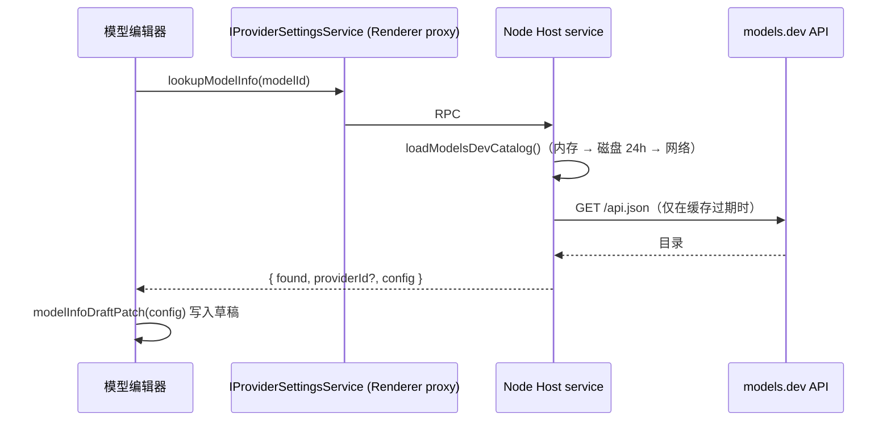

# 模型信息查询（models.dev）与 /v1/models 批量添加

状态：已实施。2026-11-10。

## 目标与边界

模型编辑器不再提供"智能配置"开关：内建推荐规则仍是继承基线，models.dev 只作为**用户主动触发**的补充查询。

- 输入模型 ID 后，表单数值字段直接填入继承基线（内建通配/精确规则），不再是纯占位符。
- 页脚"获取模型信息"按当前模型 ID 查询 models.dev，命中即覆盖 context window、max output tokens、推理档位、输入模态与结构化输出；未收录与查询失败分别提示。
- "重置表单"回到内建基线状态。
- 模型列表头部"从 /v1/models 获取"用供应商 Base URL + 密钥读取远端模型列表，多选后逐个添加；每个模型先查 models.dev，查不到则落空配置走内建基线。

查询只发生在用户点击时：`resolveModelConfig` 保持纯规则引擎结果，避免编辑表单每次输入都打网络。

## 状态所有者与调用链

- 目录缓存在 `~/.nex/runtime/models-dev/api.json`，24 小时有效；离线时退回过期数据，无任何数据时 `lookupModelInfo` 抛错（UI 显示"查询失败"而不是"未收录"）。
- 缓存写先落临时文件再 rename，避免多进程读到半截 JSON。
- 未装配 models.dev 查询的 Host（浏览器 bundle、未注入的测试环境）显式报错，避免 UI 误报"未收录"。

## 查找与聚合规则

- 命名空间感知：`cst/claude/claude-sonnet-5-5` 逐层剥离前缀，每个后缀都作为候选；大小写不敏感；目录键本身可含斜杠。
- 跨供应商同名条目按众数聚合：数值平票取更大值（聚合商常缩水上限），布尔平票取 `true`。
- `limit.output <= 0` 视为无效；推理档位必须非空、无空串、无重复，否则丢弃该条目的 `reasoning_options`。
- 输入模态：任一条目声明支持即视为支持；有模态数据时未声明类型按不支持。

## 表单填充语义

- `projectModelDraft` 把继承基线写入空的 context window / max output tokens / reasoning map 控件；用户已编辑或已显式覆盖的字段不动。
- 模型 ID 变化时，与上一份基线填充值一致的字段清空并按新 ID 重填；与基线不同的视为手改，保留。
- models.dev 命中通过 `onDraftChange` 写入草稿并标记为显式覆盖，保存时随个人配置落盘。

## /v1/models 批量添加

- 请求 `{baseUrl}/models`：`anthropic-messages` 使用 `x-api-key` + `anthropic-version`，其余使用 `Bearer`；用户自定义请求头优先，不重复写入。
- 兼容 `{data:[{id}]}`、Gemini `{models:[{name:"models/xxx"}]}` 与裸数组；去掉 Gemini 的 `models/` 前缀。
- 已配置的模型在列表中保留可见、预勾选并禁用，不进入待提交集合，避免重试时重复添加。
- 添加串行写入（避免并发写覆盖），models.dev 查询并发；单个失败收集后统一提示，不阻断其余模型。
- 批量添加共用一个通知 key 与计数，N 个模型只产生一条 pending → success/failure 提示。

## 测试

- `packages/services/test/modelsDevCatalog.test.ts`：命名空间查找、众数聚合、非法值丢弃。
- `packages/services/test/remoteModelList.test.ts`：三种响应形态、鉴权头、用户请求头优先、HTTP 失败。
- `packages/ui/test/providerModelDraft.test.ts`：基线填入、ID 变化清空、models.dev 补丁、保存落盘。
